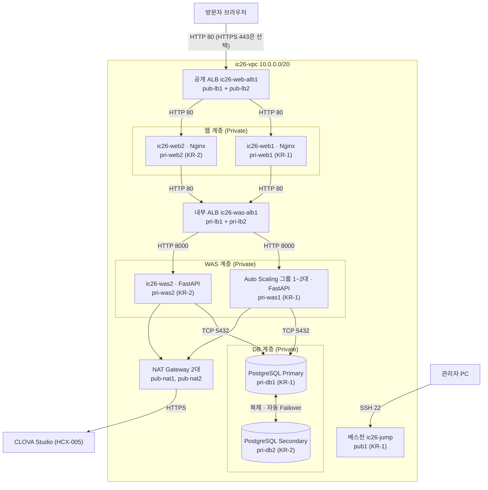

# 서버 아키텍처 (네이버클라우드, 3계층)

> **계획 문서입니다. 2026-11-13 기준으로 만든 리소스는 0개입니다.**
> 기준 코드: `main` `701955d` (실시간 호출과 키 없이 도는 시험용 실행만 있음).
> 이 문서에는 API 키, 비밀번호, 인증키, 공인 IP를 적지 않습니다. 자리표시자(`<...>`)만 씁니다.
> 표기: **[수업]** 특화교육 3주차에서 실습한 값 · **[코드]** 저장소에서 확인 · **[제안]** 아직 정해지지 않은 값 · **[확인 필요]** 콘솔이나 운영진에게 확인할 것.
> **[공식 문서]**는 네이버클라우드 사용 가이드 [Cloud DB for PostgreSQL](https://guide.ncloud-docs.com/docs/clouddbforpostgresql-overview)에서 2026-11-13에 확인한 내용입니다.
> 수업은 Rocky Linux와 MySQL로 실습했습니다. 이 문서는 Ubuntu와 PostgreSQL을 쓰므로, 네트워크 구조는 수업을 따르고 OS와 DB의 세부 값은 **[확인 필요]**로 표시했습니다.

## 1. 한눈에 보기

웹 계층(Nginx), WAS 계층(FastAPI), DB 계층(PostgreSQL)을 서브넷과 ACG로 나눕니다. 각 계층은 바로 앞 계층에서만 들어올 수 있습니다.



| 계층 | 무엇이 도나 | 어디에 | 누가 들어올 수 있나 | 비밀 값 |
|---|---|---|---|---|
| 웹 | Nginx (요청을 WAS로 넘김, `/docs` 차단) | `pri-web1`, `pri-web2` | 공개 ALB | 없음 |
| WAS | FastAPI 웹 API + 리뷰 분석 | `pri-was1`, `pri-was2` | 내부 ALB | HCX 키, DB 접속 정보 |
| DB | Cloud DB for PostgreSQL | `pri-db1`, `pri-db2` | WAS 서브넷 | DB 서비스가 관리 |

| 요소 | 구성 |
|---|---|
| 서버 구성 | VPC 1, 서브넷 13, NAT 2, ACG, 3계층 |
| 서버 이미지 | 계층마다 1개: `ic26-web-img1`, `ic26-was-img1` |
| 서버 이중화 | 세 계층 모두 KR-1과 KR-2에 하나씩 |
| Auto Scaling | WAS 계층의 KR-1 그룹, 최소 1 · 최대 2 |

## 2. 계층별 서버 안에서 도는 것

**웹 서버** (`ic26-web1`, `ic26-web2`)

| 서비스 | 포트 | 내용 |
|---|---|---|
| Nginx | 80 | 모든 요청을 내부 ALB로 넘김. `/healthz`는 Nginx가 직접 200으로 답함 |

```nginx
server {
    listen 80 default_server;
    server_tokens off;

    location = /healthz { access_log off; return 200 "ok\n"; }
    location ~ ^/(docs|redoc|openapi\.json) { return 404; }

    location / {
        proxy_pass http://<내부 ALB 주소>;
        proxy_http_version 1.1;
        proxy_set_header Host $host;
        proxy_set_header X-Forwarded-For $proxy_add_x_forwarded_for;
        proxy_set_header X-Forwarded-Proto $scheme;
        proxy_connect_timeout 5s;
        proxy_read_timeout 60s;
    }
}
```

- 글 생성이 14초를 넘을 때가 있어 `proxy_read_timeout`을 60초로 둡니다. 두 ALB의 유휴 시간 제한도 이보다 짧지 않아야 합니다 **[확인 필요]**.
- Nginx는 시작할 때 내부 ALB 주소를 한 번만 IP로 바꿉니다. ALB의 IP가 바뀌면 `nginx -s reload`가 필요합니다 **[확인 필요]**.
- 화면 파일(HTML, JS, CSS)은 지금 FastAPI가 줍니다 **[코드]**. Nginx가 직접 주도록 옮기는 것은 선택입니다 **[제안]**.

**WAS 서버** (`ic26-was2`, 그룹 서버)

| 서비스 | 포트 | 묶는 주소 | 내용 |
|---|---|---|---|
| `ic26-was` | 8000 | `0.0.0.0` | 화면과 API (`services/web`). 상태 확인 `/api/health` **[코드]** |
| `ic26-review` | 8020 | `127.0.0.1` | 리뷰 분석 (`services/review-insight`). 서버 밖에서 닿지 않음 **[코드]** |

- 두 서비스는 systemd로 띄우고 환경 파일 `/etc/ic26/env`(root 소유, 권한 600)를 읽습니다.
- HCX 호출은 WAS 서브넷에서 NAT를 거쳐 나갑니다. NAT 경로가 없으면 화면은 뜨는데 글 생성만 실패합니다 **[수업]**.
- 리뷰 분석 서버는 실시간 모드인데 키가 비어 있으면 시작하지 못합니다(`classify.py`) **[코드]**.

**서버 OS**

| 항목 | 값 | 근거 |
|---|---|---|
| OS | Ubuntu Server 22.04 LTS | **[제안]** 콘솔의 이미지 이름은 **[확인 필요]** |
| 파이썬 | 3.11 (`python3.11`, `python3.11-venv`) | 개발 환경이 3.11 **[코드]**. 22.04 저장소에 패키지가 있는지 **[확인 필요]** |
| 패키지 설치 | `apt` | 수업은 Rocky의 `dnf` |
| 방화벽 | `ufw`가 꺼져 있는지 확인 | 서버 접근은 ACG로 막음 |
| 스펙 | `s2-g3a` (2vCPU, 8GB) | **[수업]** |

Ubuntu 24.04만 고를 수 있으면 파이썬이 3.12입니다. 그 경우 서버에서 `pytest`를 먼저 돌려 `kiwipiepy` 등이 설치되는지 확인합니다.

## 3. 네트워크

### 3-1. 서브넷 13개

| 이름 | 대역 | Zone | 공개 여부 | 용도(유형) | 계층 · 들어가는 것 |
|---|---|---|---|---|---|
| `ic26-pri-was1` | 10.0.0.0/23 | KR-1 | Private | 일반 | WAS · Auto Scaling 그룹 |
| `ic26-pub1` | 10.0.2.0/24 | KR-1 | Public | 일반 | 베스천 |
| `ic26-pri-db1` | 10.0.3.0/24 | KR-1 | Private | 일반 | DB · Primary |
| `ic26-pub-nat1` | 10.0.4.0/24 | KR-1 | Public | NatGateway | `ic26-natgw1` |
| `ic26-pub-lb1` | 10.0.5.0/24 | KR-1 | Public | LoadBalancer | 공개 ALB |
| `ic26-pri-web1` | 10.0.7.0/24 | KR-1 | Private | 일반 | 웹 · `ic26-web1` |
| `ic26-pri-lb1` | 10.0.6.0/24 | KR-1 | Private | LoadBalancer | 내부 ALB |
| `ic26-pri-was2` | 10.0.8.0/23 | KR-2 | Private | 일반 | WAS · `ic26-was2` |
| `ic26-pri-db2` | 10.0.11.0/24 | KR-2 | Private | 일반 | DB · Secondary |
| `ic26-pub-nat2` | 10.0.12.0/24 | KR-2 | Public | NatGateway | `ic26-natgw2` |
| `ic26-pub-lb2` | 10.0.13.0/24 | KR-2 | Public | LoadBalancer | 공개 ALB |
| `ic26-pri-web2` | 10.0.15.0/24 | KR-2 | Private | 일반 | 웹 · `ic26-web2` |
| `ic26-pri-lb2` | 10.0.14.0/24 | KR-2 | Private | LoadBalancer | 내부 ALB |

- WAS, DB, NAT, 공개 LB, 내부 LB 서브넷의 대역은 수업의 Multi Zone 설계와 같습니다 **[수업]**. 수업은 내부 LB 서브넷(Private Load Balancer 유형)을 설계표에 넣고 실습에서는 만들지 않았습니다.
- 웹 서브넷 2개는 수업이 예비로 비워 둔 대역(10.0.7.0/24, 10.0.15.0/24)에 넣었습니다 **[제안]**.

### 3-2. 라우트 테이블과 NAT

| 이름 | 연결 서브넷 | 경로 |
|---|---|---|
| 공인(기본) | pub1, pub-nat1, pub-nat2, pub-lb1, pub-lb2 | `0.0.0.0/0` → IGW |
| `ic26-rt-pri1` | pri-web1, pri-was1 | `0.0.0.0/0` → `ic26-natgw1` |
| `ic26-rt-pri2` | pri-web2, pri-was2 | `0.0.0.0/0` → `ic26-natgw2` |
| `ic26-rt-local` | pri-db1, pri-db2, pri-lb1, pri-lb2 | LOCAL만 (밖으로 나가는 길 없음) |

웹 서버는 운영 중에는 밖으로 나갈 일이 없고, 패키지를 설치할 때만 NAT를 씁니다.

### 3-3. ACG

| ACG | 프로토콜 · 포트 | 접근 소스 | 용도 |
|---|---|---|---|
| `ic26-web-acg` | TCP 80 | 10.0.5.0/24, 10.0.13.0/24 | 공개 ALB → 웹 |
| `ic26-web-acg` | TCP 22 | 10.0.2.0/24 | 베스천 → 웹 |
| `ic26-was-acg` | TCP 8000 | 10.0.6.0/24, 10.0.14.0/24 | 내부 ALB → WAS |
| `ic26-was-acg` | TCP 22 | 10.0.2.0/24 | 베스천 → WAS |
| DB의 ACG | TCP 5432 | 10.0.0.0/23, 10.0.8.0/23 | WAS → DB |
| `ic26-jump-acg` | TCP 22 | 관리자 IP | 베스천 SSH |

- 웹 서버는 DB에 닿지 않고, 방문자는 WAS에 직접 닿지 않습니다.
- 열지 않는 것: 8020(리뷰 분석), 기본 ACG의 전체 공개 22·3389.
- DB 서비스가 자동으로 만든 ACG 규칙은 지우지 않습니다 **[수업]**.
- Outbound는 기본값을 둡니다. 막으면 HCX 호출이 끊깁니다.

## 4. 서버, 로드 밸런서, Auto Scaling

| 이름 | 계층 | 서브넷 | 공인 IP | 만드는 방식 |
|---|---|---|---|---|
| `ic26-jump` | 관리 | pub1 | 있음 | 수동 |
| `ic26-web1` | 웹 | pri-web1 | 없음 | 수동. 여기서 설치하고 `ic26-web-img1`을 만듦 |
| `ic26-web2` | 웹 | pri-web2 | 없음 | `ic26-web-img1`에서 |
| `ic26-was1` | WAS | pri-was1 | 없음 | 수동. 여기서 설치하고 `ic26-was-img1`을 만듦. 뒤에 그룹으로 바꿈 |
| `ic26-was2` | WAS | pri-was2 | 없음 | `ic26-was-img1`에서 |
| 그룹 서버 1~2대 | WAS | pri-was1 | 없음 | Auto Scaling (`ic26-was1` 자리) |

- 이미지 원본 서버를 따로 두지 않습니다. 프라이빗 서버에 베스천을 거쳐 접속해 설치하고, 그 서버에서 이미지를 만듭니다.
- **서버 쿼터는 `Standard G3` 기본 5대입니다 [수업].** 베스천 1 + 웹 2 + WAS 2로 5대를 다 씁니다. Auto Scaling이 2대째를 만들려면 6대가 필요하므로 쿼터 상향을 신청해야 합니다(약 3일 **[수업]**).

| 리소스 | 값 |
|---|---|
| 공개 ALB `ic26-web-alb1` | Public, Small, `pub-lb1` + `pub-lb2`, 리스너 HTTP 80 → `ic26-web-tg1` |
| 타겟 그룹 `ic26-web-tg1` | HTTP 80, 상태 확인 `/healthz`, 대상 web1 · web2 |
| 내부 ALB `ic26-was-alb1` | Private, Small, `pri-lb1` + `pri-lb2`, 리스너 HTTP 80 → `ic26-was-tg1` **[확인 필요]** |
| 타겟 그룹 `ic26-was-tg1` | HTTP 8000, 상태 확인 `/api/health`, 대상 was2 + 그룹 서버 |
| Launch Configuration `ic26-was-lc1` | 이미지 `ic26-was-img1`, `s2-g3a`, Init Script `ic26-was-init1` |
| Auto Scaling 그룹 `ic26-was-asg1` | 서브넷 `pri-was1`, 최소 1 · 최대 2 · 기대 1, 상태 확인 유형 로드밸런서, 보류 300초 |
| 증설 정책 | CPU 평균 60% 초과 1분 → 1대 증가 **[제안]** |
| 축소 정책 | CPU 평균 20% 미만 5분 → 1대 감소 **[제안]**. 축소는 정책을 따로 만들어야 함 **[수업]** |

- 수업은 공개 ALB만 다뤘습니다. 내부 ALB를 만들 수 없으면 내부 NLB(TCP 8000)로 바꿉니다.
- Auto Scaling은 WAS 계층에만 겁니다. 웹 계층은 넘기기만 해서 CPU를 거의 쓰지 않습니다.
- Auto Scaling은 WAS의 CPU에 반응합니다. HCX 호출 한도(테스트 앱 분당 60회)는 서버를 늘려도 그대로입니다.

## 5. DB

### 5-1. 왜 넣는가

지금 코드는 DB를 쓰지 않습니다. 데이터는 git에 올린 파일, 서버 메모리, 서버 디스크에 있습니다 **[코드]**. 아래 두 가지 때문에 DB를 넣습니다.

| 이유 | 지금 | DB를 넣으면 |
|---|---|---|
| **월별 리포트** | 리뷰와 분류 결과가 달마다 쌓일 곳이 없음 | 달마다 집계를 저장하고 지난 달과 비교 |
| **방문자별 상태** | 승인 기록은 서버 메모리, 붙여넣은 리뷰는 서버 디스크 **[코드]**. WAS가 2대 이상이면 새로고침마다 내용이 달라짐 | 모든 WAS가 같은 내용을 봄. 이중화와 Auto Scaling을 공개 링크에 쓸 수 있게 됨 |

DB만으로는 방문자끼리 섞이는 문제가 풀리지 않습니다. 방문자를 구분하는 값(브라우저에 둔 임의의 ID)을 함께 저장해야 합니다.

### 5-2. 구성

네이버클라우드의 Cloud DB for PostgreSQL을 고가용성 + Multi Zone으로 씁니다. 수업은 MySQL로 실습했으므로 PostgreSQL에 해당하는 값은 네이버클라우드 사용 가이드로 확인해 **[공식 문서]**로 표시했습니다.

| 항목 | 값 | 근거 |
|---|---|---|
| 서비스 | Cloud DB for PostgreSQL (네이버클라우드 관리형). 버전은 생성 화면에서 고름 | **[확인 필요]** 버전 목록 |
| 고가용성 | 체크. Primary와 Secondary 두 대로 이중화 | **[공식 문서]** |
| Multi Zone | 체크. Primary와 Secondary를 두 Zone에 한 대씩 | **[공식 문서]** |
| Primary / Secondary 위치 | `ic26-pri-db1` (KR-1) / `ic26-pri-db2` (KR-2) | 서브넷을 Zone마다 고르는 화면은 **[확인 필요]** |
| 타입 | 생성 화면에서 고를 수 있는 가장 작은 타입. 스토리지는 10GB에서 시작해 10GB씩 자동 증가 | 스토리지 **[공식 문서]**, 타입 **[확인 필요]** |
| 이름 | DB 서버 `ic26-db`, 서비스 `ic26-dbsvc`, 기본 DB `ic26app` | **[제안]** |
| 포트 | 5432 (기본값. 만든 뒤에는 바꿀 수 없음) | **[공식 문서]** |
| 사용자 접근 제어 | CIDR로 적음: `10.0.0.0/23`, `10.0.8.0/23` (WAS 서브넷) | **[공식 문서]** |
| ACG | 생성할 때 자동으로 만들어짐. 여기에 5432 ← WAS 서브넷 규칙을 넣음 | **[공식 문서]** |
| 백업 | 고가용성을 고르면 자동 백업, 보관 1일이 기본값 | **[공식 문서]** |
| 생성 시간 | 수업의 MySQL은 약 20분. 가장 먼저 시작해 둠 | **[수업]** |

- WAS는 DB의 Private 도메인으로 접속합니다. 가이드는 "DNS로 접근이 가능하기 때문에 별도의 애플리케이션 변경이 필요 없다"고 적고 있습니다 **[공식 문서]**. 전환 뒤 같은 주소로 붙는지는 장애 시험에서 한 번 확인합니다.
- DB 접속 정보는 HCX 키와 같은 방식으로 다룹니다. WAS의 `/etc/ic26/env`에만 두고, 이미지를 만들 때는 비우고, Auto Scaling 서버에는 Init Script가 넣습니다.

  ```ini
  DB_HOST=<DB 사설 도메인>
  DB_PORT=5432
  DB_NAME=ic26app
  DB_USER=<DB 사용자>
  DB_PASSWORD=<DB 비밀번호>
  ```

  변수 이름은 **[제안]**입니다. 코드가 DB를 쓰게 될 때 정합니다.

### 5-3. KR-1이 멈추면 DB는 어떻게 넘어가나

1. 평소에는 Primary(KR-1)가 읽기와 쓰기를 모두 받습니다. Secondary(KR-2)는 복제만 받고, 사용자가 직접 접속할 수 없습니다 **[공식 문서]**.
2. Primary에 장애가 나면 Secondary로 **자동 Failover**됩니다 **[공식 문서]**. 콘솔의 `DB 관리 > DB Failover`로 사람이 직접 전환할 수도 있습니다.
3. 전환에는 몇 분이 걸리고, 그동안 DB 접속이 되지 않습니다 **[공식 문서]**. 수업의 MySQL 실습에서는 약 5분이었습니다 **[수업]**.
4. WAS는 같은 Private 도메인으로 다시 접속합니다. 끊긴 연결을 버리고 새로 맺도록 연결 풀에 접속 확인 설정을 넣어야 합니다(5-5의 코드 작업).
5. 전환되는 동안에도 글 생성은 됩니다. HCX 호출은 DB를 거치지 않습니다. 월별 리포트와 승인 기록처럼 DB에 쓰는 기능만 멈춥니다.

같은 순간에 웹과 WAS는 로드 밸런서가 KR-2 쪽 서버로만 보냅니다. Auto Scaling 그룹과 베스천은 KR-1에만 있어서, KR-1이 멈춘 동안에는 WAS를 늘리거나 SSH로 들어갈 수 없습니다.

### 5-4. 저장할 것 [제안]

월별 리포트의 화면과 범위는 아직 정해지지 않았습니다. 아래는 출발점입니다.

| 테이블 | 내용 | 쓰는 곳 |
|---|---|---|
| `stores` | 가게 | 공통 |
| `reviews` | 리뷰 원문, 채널, 별점, 작성일, 방문자 ID(붙여넣은 리뷰일 때) | 리뷰 분석 |
| `review_labels` | 리뷰별 감정, 주제, 프롬프트 버전 | 리뷰 분석 |
| `monthly_reports` | 가게 · 연월별 집계(리뷰 수, 불만 비율, 주제별 건수, 반복 불만), 생성 시각 | 월별 리포트 |
| `approvals` | 승인한 초안, 방문자 ID, 시각 | 처리 완료 기록 |

- 합성 리뷰 100건과 벤치마크 데이터는 계속 git 파일에 둡니다. DB에는 실행 중에 생기는 것만 넣습니다.
- 실제 사장님의 리뷰나 개인정보를 넣게 되면 보관 기간과 삭제 방법을 먼저 정합니다.

### 5-5. DB를 넣으면 해야 하는 코드 작업

| 작업 | 위치 |
|---|---|
| PostgreSQL 드라이버(`psycopg`) 추가 | `services/web/requirements.txt`, `services/review-insight/requirements.txt` |
| 승인 기록을 메모리에서 DB로 | `services/web/web/demo.py` |
| 붙여넣은 리뷰와 그 분류 결과를 디스크에서 DB로 | `services/review-insight/app/service.py`, `classify.py` |
| 월별 집계 저장과 조회 | 새로 만듦 |
| 연결 풀에 접속 확인과 재접속 | DB를 쓰는 모든 곳. Failover 뒤 끊긴 연결을 다시 맺기 위함 |
| DB 없이 도는 시험용 실행 유지 | 키와 DB 없이 `pytest`가 계속 돌아야 함 |

## 6. 비밀 값 다루기

- 비밀 값은 WAS 계층에만 있습니다. 웹 서버에는 키도 DB 접속 정보도 두지 않습니다.
- 서버에는 서버 전용 HCX 키만 둡니다. 개발용 키 파일을 서버로 복사하지 않습니다.
- 키와 DB 비밀번호는 `/etc/ic26/env` 한 곳에 둡니다. 저장소, 문서, 메신저, 캡처에 남기지 않습니다.
- WAS 이미지를 만들 때는 이 파일의 값을 비웁니다 **[수업]**.
- Auto Scaling 서버에는 Init Script가 값을 넣습니다. 이 방식도 값이 콘솔에 평문으로 남습니다. 키가 든 이미지와 같은 종류의 위험이고, 이미지가 깨끗하고 지울 곳이 한 곳이라는 점만 낫습니다. Init Script 화면은 캡처하지 않습니다.
- 삭제할 때 서버 전용 키를 CLOVA Studio에서 폐기합니다.

## 7. 만드는 순서와 지우는 순서

**만드는 순서**

1. VPC → 서브넷 13개 → 라우트 테이블
2. **DB 생성 시작** (기다리는 동안 다음 단계 진행)
3. NAT 2대 + 사설 경로 → ACG
4. 베스천 → `ic26-was1` 설치와 확인 → WAS 이미지 → `ic26-was2`
5. 내부 ALB와 타겟 그룹
6. `ic26-web1` 설치(Nginx가 내부 ALB를 가리킴) → 웹 이미지 → `ic26-web2`
7. 공개 ALB와 타겟 그룹 → 계층별 장애 시험
8. DB의 ACG에 5432 추가 → WAS에서 접속 확인 → DB 장애 시험
9. Auto Scaling (`ic26-was1`을 그룹으로 교체) → 증설 시험
10. (선택) 도메인과 HTTPS

**지우는 순서** (되돌릴 수 없음)

1. Auto Scaling: 용량 0 → 정책, 그룹 → Launch Configuration → Init Script
2. 서버 → 공개 ALB, 내부 ALB, 타겟 그룹 → DNS 레코드, 인증서
3. **DB** (지우기 전에 남길 데이터가 있는지 확인)
4. 서버 이미지 2개 → 사설 경로 → NAT → 서브넷 → VPC
5. 서버 전용 HCX 키 폐기

## 8. 잘 안 될 때 줄이는 순서

3계층을 한 번에 무너뜨리지 않고, 잃는 것이 적은 것부터 한 단계씩 줄입니다. 기한은 **[제안]**입니다.

| 순서 | 줄이는 것 | 이럴 때 | 남는 것 | 이미 만든 것은 |
|---|---|---|---|---|
| 0 | **내부 ALB → 내부 NLB** | Private ALB를 만들 수 없을 때 (만드는 날 바로) | 3계층 그대로 | 내부 NLB(TCP 8000)로 바꾸고 Nginx가 그 주소를 가리키게 함. WAS ACG 8000의 접근 소스를 다시 확인 |
| 1 | **웹 계층 + 내부 로드 밸런서** | 11/15 밤까지 웹 → 내부 로드 밸런서 → WAS 경로로 글 생성이 안 될 때 | 공개 ALB → WAS 2대 → DB. 수업이 말한 3 tier(공개 LB, 서버, DB)와 같음 | 공개 ALB의 리스너가 WAS 타겟 그룹(HTTP 8000, `/api/health`)을 가리키게 하고, WAS ACG 8000의 접근 소스를 공개 LB 서브넷(10.0.5.0/24, 10.0.13.0/24)으로 바꿈. 웹 서버 2대와 내부 로드 밸런서는 지움. 서브넷은 무과금이라 둠 |
| 2 | **HTTPS** | 11/19까지 안 될 때 | HTTP 주소 + 시연 영상 링크 | 도메인을 이미 샀으면 그대로 둠 |
| 3 | **Auto Scaling** | 쿼터 상향이 11/16까지 안 오거나, Init Script로 키가 안 들어가거나, 방문자별 상태가 안 풀릴 때 | 그룹을 최소 1 · 최대 1로 두거나, 그룹을 지우고 수동 WAS 2대 | 11/17까지 안 되면 지움. 구성도에는 점선 |
| 4 | **DB 코드 연동** | 11/15 파트 완료 때까지 코드가 DB를 쓰지 않을 때 | DB는 구성과 장애 전환 캡처만. 서비스는 지금처럼 파일과 메모리 | 월간 보고서가 DB를 전제로 합의된 기능이라 팀 협의가 필요. 인프라 담당 혼자 정하지 않음 |
| 5 | **Multi Zone 전체 (최후)** | 두 Zone 설정이 거듭 실패할 때 | KR-1 단일 Zone. 서버 구성, 이미지, Auto Scaling은 남고 이중화 증거는 잃음 | KR-2의 서버, NAT, DB Secondary를 지움. 권하지 않음 |

**순서의 근거**

- **1번이 가장 먼저입니다.** 가점 요소 네 가지(서버 구성, 이미지, 이중화, Auto Scaling)는 웹 계층이 없어도 채워집니다. 서버가 4대로 줄어 쿼터 5대에 한 자리가 남으므로 3번의 쿼터 문제도 함께 풀립니다. 수업 노트도 "공개 LB, 서버, DB로 이어지는 3 tier 구조"라고 적고 있어 **[수업]**, 줄인 뒤에도 3 tier라고 말할 수 있습니다.
- **1번으로 잃는 것이 하나 있습니다.** Nginx가 막던 `/docs`가 다시 열립니다. FastAPI에서 문서 페이지를 끄는 코드 수정이 필요합니다.
- **3번의 이득은 코드를 갱신할 때도 나옵니다.** Auto Scaling을 쓰면 코드를 고칠 때마다 이미지와 Launch Configuration을 새로 만들어야 합니다. 수동 서버 2대면 올리고 서비스만 재시작하면 됩니다.
- **4번은 인프라 일이 아니라 제품 일입니다.** 4차 회의(11/13)에서 주간·월간 보고서와 DB를 함께 합의했습니다.
- **5번은 권하지 않습니다.** 이중화는 가점 요소이고, 한쪽 Zone이 멈춰도 서비스가 이어진다는 설명의 근거입니다.

**최소선:** 공개 ALB → WAS(수동 1~2대) → NAT → HyperCLOVA X 호출. 이것이 서버에 올리기로 한 11/17까지 돌면, 나머지는 그 위에 얹는 일입니다. 제출물(발표 자료, 영상)에 문제가 생기면 인프라 작업을 멈추고 서버는 그대로 둡니다.

**줄인 것은 그대로 적습니다.** 구성도에서 만든 것은 실선, 만들지 않은 것은 점선으로 그립니다. 문서에는 "웹 계층은 구축하지 않았고 확장 계획이다"처럼 씁니다. 만들지 않은 것을 만든 것처럼 적지 않습니다.

**OS:** Ubuntu에서 파이썬 3.11이나 `kiwipiepy` 설치가 막히면, Ubuntu 24.04(파이썬 3.12)에서 `pytest`를 돌려 보고, 그래도 안 되면 수업에서 실습한 Rocky로 돌아갑니다. 구성도는 바뀌지 않습니다.

## 9. 아직 정해지지 않았거나 확인이 필요한 것

| 항목 | 상태 |
|---|---|
| 서버 쿼터 | 5대를 다 씀. Auto Scaling에는 6대 이상이 필요해 상향 신청이 필요 |
| DB 서버 2대가 서버 쿼터에 들어가는지 | **[확인 필요]** 들어가면 지금 쿼터로는 구성할 수 없음 |
| 내부 ALB(Private)를 만들 수 있는지 | **[확인 필요]** 수업은 Private LB 서브넷을 설계만 하고 내부 로드 밸런서는 만들지 않음. 안 되면 8절의 0번 |
| Ubuntu 이미지 이름과 버전, 기본 접속 계정 | **[확인 필요]** 수업은 Rocky만 다룸 |
| Ubuntu에서 파이썬 3.11 설치 | **[확인 필요]** |
| PostgreSQL 생성 화면에서 Multi Zone일 때 서브넷을 Zone마다 고르는 방법, 고를 수 있는 버전과 최소 타입 | **[확인 필요]** 가이드에는 Subnet 항목이 하나만 나옴 |
| DB 복제가 동기인지 비동기인지 | **[확인 필요]** 가이드에서 찾지 못함. 전환 직전의 쓰기가 남는지와 관련 |
| 월별 리포트의 화면과 범위 | 미정. 5-4의 테이블은 이에 따라 바뀜 |
| DB 백업 설정 | 고가용성을 고르면 자동 백업, 보관 1일이 기본값 **[공식 문서]**. 보관 기간을 늘릴지 정함 |
| Failover 뒤 같은 Private 도메인으로 붙는지 | 가이드상 애플리케이션 변경이 필요 없음. 장애 시험에서 확인 |
| 두 ALB의 유휴 시간 제한 | **[확인 필요]** 글 생성이 14초를 넘을 때가 있음 |
| Auto Scaling 그룹에 두 서브넷을 함께 고를 수 있는지 | **[확인 필요]** 수업은 하나만 걸었음 |
| HTTPS 인증서 등록 | 수업에서 다루지 않음 |
| 베스천 서버 스펙 | 미정 |

## 10. 일정

| 기간 | 하는 일 |
|---|---|
| 11/14 ~ 11/15 | 네트워크, DB, 서버, ALB 2대 구축 (지금의 `main`으로) |
| 11/16 ~ 11/17 | 장애 시험, Auto Scaling, HTTPS. 11/17에 파트별 완료본을 서버에 올림(4차 회의 목표) |
| 11/18 ~ 11/19 | 코드 동결 뒤 버전으로 갱신 |
| 11/20 ~ 11/21 | 공개 링크 전 점검 |
| 11/26 행사 뒤 ~ 11/27 정오 | 전부 삭제 |

코드가 DB를 쓰기 전까지 DB는 만들어 두기만 한 상태입니다. 11/15 기능 동결까지 5-5의 코드 작업이 들어가지 않으면, DB는 구성과 장애 시험만 보여 주고 서비스는 지금처럼 파일과 메모리로 돕니다.
