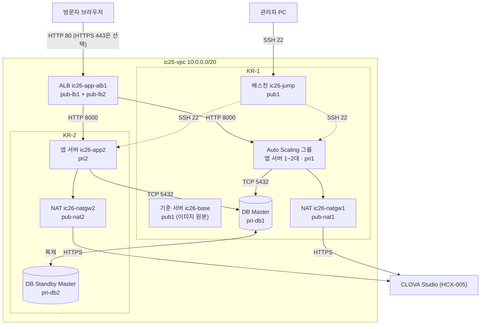

# 서버 아키텍처 (네이버클라우드)

> **계획 문서입니다. 2026-11-13 기준으로 만든 리소스는 0개입니다.**
> 기준 코드: `main` `701955d` (실시간 호출과 키 없이 도는 시험용 실행만 있음).
> 이 문서에는 API 키, 비밀번호, 인증키, 공인 IP를 적지 않습니다. 자리표시자(`<...>`)만 씁니다.
> 표기: **[수업]** 특화교육 3주차에서 실습한 값 · **[코드]** 저장소에서 확인 · **[제안]** 아직 정해지지 않은 값 · **[확인 필요]** 콘솔이나 운영진에게 확인할 것.

## 1. 한눈에 보기



| 요소 | 구성 | 목적 |
|---|---|---|
| 서버 구성 | VPC 1, 서브넷 9, NAT 2, ACG | Public / Private / DB를 나눔 |
| 서버 이미지 | 기준 서버에서 만든 `ic26-app-img1` | 앱 서버를 같은 내용으로 찍어 냄 |
| 서버 이중화 | 앱 서버를 KR-1과 KR-2에 두고 ALB로 묶음 | 한 Zone이 멈춰도 서비스 유지 |
| Auto Scaling | KR-1 그룹 최소 1 · 최대 2 | CPU가 오르면 서버를 늘림 |
| DB | Cloud DB for PostgreSQL, 고가용성 + Multi Zone | 월별 리포트와 방문자별 상태를 서버 밖에 저장 |

## 2. 앱 서버 한 대 안에서 도는 것

| 서비스 | 포트 | 묶는 주소 | 내용 |
|---|---|---|---|
| `ic26-web` | 8000 | `0.0.0.0` | 화면과 API (`services/web`). 상태 확인 `/api/health` **[코드]** |
| `ic26-review` | 8020 | `127.0.0.1` | 리뷰 분석 (`services/review-insight`). 서버 밖에서 닿지 않음 **[코드]** |

- 두 서비스는 systemd로 띄우고 환경 파일 `/etc/ic26/env`(root 소유, 권한 600)를 읽습니다.
- HCX 호출은 프라이빗 서브넷에서 NAT를 거쳐 나갑니다. NAT 경로가 없으면 화면은 뜨는데 글 생성만 실패합니다 **[수업]**.
- 리뷰 분석 서버는 실시간 모드인데 키가 비어 있으면 시작하지 못합니다(`classify.py`) **[코드]**.

## 3. 네트워크

### 3-1. 서브넷 9개

| 이름 | 대역 | Zone | 공개 여부 | 용도(유형) | 들어가는 것 |
|---|---|---|---|---|---|
| `ic26-pri1` | 10.0.0.0/23 | KR-1 | Private | 일반 | 앱 서버(Auto Scaling 그룹) |
| `ic26-pub1` | 10.0.2.0/24 | KR-1 | Public | 일반 | 베스천, 기준 서버 |
| `ic26-pri-db1` | 10.0.3.0/24 | KR-1 | Private | 일반 | DB Master |
| `ic26-pub-nat1` | 10.0.4.0/24 | KR-1 | Public | NatGateway | `ic26-natgw1` |
| `ic26-pub-lb1` | 10.0.5.0/24 | KR-1 | Public | LoadBalancer | ALB |
| `ic26-pri2` | 10.0.8.0/23 | KR-2 | Private | 일반 | 앱 서버 `ic26-app2` |
| `ic26-pri-db2` | 10.0.11.0/24 | KR-2 | Private | 일반 | DB Standby Master |
| `ic26-pub-nat2` | 10.0.12.0/24 | KR-2 | Public | NatGateway | `ic26-natgw2` |
| `ic26-pub-lb2` | 10.0.13.0/24 | KR-2 | Public | LoadBalancer | ALB |

대역은 수업의 Multi Zone 설계와 같습니다 **[수업]**. DB 서버는 만든 뒤 서브넷을 옮길 수 없습니다 **[수업]**.

### 3-2. 라우트 테이블과 NAT

| 이름 | 연결 서브넷 | 경로 |
|---|---|---|
| 공인(기본) | pub1, pub-nat1, pub-nat2, pub-lb1, pub-lb2 | `0.0.0.0/0` → IGW |
| `ic26-rt-pri1` | pri1 | `0.0.0.0/0` → `ic26-natgw1` |
| `ic26-rt-pri2` | pri2 | `0.0.0.0/0` → `ic26-natgw2` |
| `ic26-rt-db` | pri-db1, pri-db2 | LOCAL만 (밖으로 나가는 길 없음) **[수업]** |

### 3-3. ACG

| ACG | 프로토콜 · 포트 | 접근 소스 | 용도 |
|---|---|---|---|
| `ic26-app-acg` | TCP 8000 | 10.0.0.0/20 | ALB → 웹 서버 |
| `ic26-app-acg` | TCP 22 | 10.0.2.0/24 | 베스천 → 앱 서버 |
| `ic26-jump-acg` | TCP 22 | 관리자 IP | 베스천 SSH |
| DB의 ACG | TCP 5432 | 10.0.0.0/23, 10.0.8.0/23 | 앱 서버 → DB (구조는 **[수업]**, 포트는 PostgreSQL 기본값) |

- 열지 않는 것: 8020(리뷰 분석), 서버의 80, 기본 ACG의 전체 공개 22·3389.
- DB 서비스가 자동으로 만든 ACG 규칙은 지우지 않습니다 **[수업]**.
- Outbound는 기본값을 둡니다. 막으면 HCX 호출이 끊깁니다.

## 4. 서버, 로드 밸런서, Auto Scaling

| 이름 | 역할 | 서브넷 | 공인 IP | 만드는 방식 |
|---|---|---|---|---|
| `ic26-jump` | 베스천 | pub1 | 있음 | 수동 |
| `ic26-base` | 기준 서버 (이미지 원본) | pub1 | 있음 | 수동. 이미지를 만든 뒤에는 키를 두지 않음 |
| `ic26-app2` | 앱 서버 | pri2 | 없음 | 수동 |
| 그룹 서버 1~2대 | 앱 서버 | pri1 | 없음 | Auto Scaling |

- 스펙은 `s2-g3a`(2vCPU, 8GB), 이미지는 `rocky-9.8-base` **[수업]**.
- 서버 쿼터는 `Standard G3` 기본 5대입니다 **[수업]**. 위 구성이 최대일 때 정확히 5대입니다.

| 리소스 | 값 |
|---|---|
| ALB `ic26-app-alb1` | Public, Small, `pub-lb1` + `pub-lb2`, 리스너 HTTP 80 |
| 타겟 그룹 `ic26-app-tg1` | HTTP 8000, 상태 확인 `/api/health` |
| Launch Configuration `ic26-app-lc1` | 이미지 `ic26-app-img1`, `s2-g3a`, Init Script `ic26-app-init1` |
| Auto Scaling 그룹 `ic26-app-asg1` | 서브넷 `pri1`, 최소 1 · 최대 2 · 기대 1, 상태 확인 유형 로드밸런서, 보류 300초 |
| 증설 정책 | CPU 평균 60% 초과 1분 → 1대 증가 **[제안]** |
| 축소 정책 | CPU 평균 20% 미만 5분 → 1대 감소 **[제안]**. 축소는 정책을 따로 만들어야 함 **[수업]** |

Auto Scaling은 웹 서버 CPU에 반응합니다. HCX 호출 한도(테스트 앱 분당 60회)는 서버를 늘려도 그대로입니다.

## 5. DB

### 5-1. 왜 넣는가

지금 코드는 DB를 쓰지 않습니다. 데이터는 git에 올린 파일, 서버 메모리, 서버 디스크에 있습니다 **[코드]**. 아래 두 가지 때문에 DB를 넣습니다.

| 이유 | 지금 | DB를 넣으면 |
|---|---|---|
| **월별 리포트** | 리뷰와 분류 결과가 달마다 쌓일 곳이 없음 | 달마다 집계를 저장하고 지난 달과 비교 |
| **방문자별 상태** | 승인 기록은 서버 메모리, 붙여넣은 리뷰는 서버 디스크 **[코드]**. 서버가 2대 이상이면 새로고침마다 내용이 달라짐 | 모든 앱 서버가 같은 내용을 봄. 이중화와 Auto Scaling을 공개 링크에 쓸 수 있게 됨 |

DB만으로는 방문자끼리 섞이는 문제가 풀리지 않습니다. 방문자를 구분하는 값(브라우저에 둔 임의의 ID)을 함께 저장해야 합니다.

### 5-2. 구성

수업은 MySQL로 실습했습니다. 고가용성, Multi Zone, 서브넷 두 개, ACG를 앱 서버 대역에만 여는 구조는 그대로 따르고, PostgreSQL 생성 화면의 항목과 값은 화면에서 확인합니다 **[확인 필요]**.

| 항목 | 값 | 근거 |
|---|---|---|
| 서비스 | Cloud DB for PostgreSQL. 버전은 화면에서 고를 수 있는 최신 안정 버전 | **[확인 필요]** |
| 고가용성 | 체크 (Standby 포함 2대) | **[수업]** |
| Multi Zone | 체크 | **[수업]** |
| Master / Standby 서브넷 | `ic26-pri-db1` (KR-1) / `ic26-pri-db2` (KR-2) | **[수업]** |
| 타입 | Standard 2vCPU · 8GB, 스토리지 10GB | **[수업]** |
| 이름 | DB 서버 `ic26-db`, 서비스 `ic26-dbsvc`, 기본 DB `ic26app` | **[제안]** |
| 포트 | 5432 (PostgreSQL 기본값) | **[확인 필요]** |
| 사용자 접근 제어 | 앱 서버가 있는 대역으로 좁힘 (`10.0.0.0/20`) | 입력 형식 **[확인 필요]** |
| 생성 시간 | 수업의 MySQL은 약 20분. 가장 먼저 시작해 둠 | **[수업]** |

- 앱 서버는 DB의 사설 도메인으로 접속합니다. Master가 바뀌어도 주소가 유지되는지는 장애 시험에서 확인합니다 **[확인 필요]**.
- DB 접속 정보는 HCX 키와 같은 방식으로 다룹니다. `/etc/ic26/env`에 두고, 이미지를 만들 때는 비우고, Auto Scaling 서버에는 Init Script가 넣습니다.

  ```ini
  DB_HOST=<DB 사설 도메인>
  DB_PORT=5432
  DB_NAME=ic26app
  DB_USER=<DB 사용자>
  DB_PASSWORD=<DB 비밀번호>
  ```

  변수 이름은 **[제안]**입니다. 코드가 DB를 쓰게 될 때 정합니다.

### 5-3. 저장할 것 [제안]

월별 리포트의 화면과 범위는 아직 정해지지 않았습니다. 아래는 출발점입니다.

| 테이블 | 내용 | 쓰는 곳 |
|---|---|---|
| `stores` | 가게 | 공통 |
| `reviews` | 리뷰 원문, 채널, 별점, 작성일, 방문자 ID(붙여넣은 리뷰일 때) | 리뷰 분석 |
| `review_labels` | 리뷰별 감정, 주제, 프롬프트 버전 | 리뷰 분석 |
| `monthly_reports` | 가게 · 연월별 집계(리뷰 수, 불만 비율, 주제별 건수, 반복 불만), 생성 시각 | 월별 리포트 |
| `approvals` | 승인한 초안, 방문자 ID, 시각 | 처리 완료 기록 |

- 합성 리뷰 100건과 벤치마크 데이터는 계속 git 파일에 둡니다. DB에는 실행 중에 생기는 것만 넣습니다.
- 실제 사장님의 리뷰나 개인정보를 넣게 되면 보관 기간과 삭제 방법을 먼저 정합니다.

### 5-4. DB를 넣으면 해야 하는 코드 작업

| 작업 | 위치 |
|---|---|
| PostgreSQL 드라이버(`psycopg`) 추가 | `services/web/requirements.txt`, `services/review-insight/requirements.txt` |
| 승인 기록을 메모리에서 DB로 | `services/web/web/demo.py` |
| 붙여넣은 리뷰와 그 분류 결과를 디스크에서 DB로 | `services/review-insight/app/service.py`, `classify.py` |
| 월별 집계 저장과 조회 | 새로 만듦 |
| DB 없이 도는 시험용 실행 유지 | 키와 DB 없이 `pytest`가 계속 돌아야 함 |

## 6. 비밀 값 다루기

- 서버에는 서버 전용 HCX 키만 둡니다. 개발용 키 파일을 서버로 복사하지 않습니다.
- 키와 DB 비밀번호는 `/etc/ic26/env` 한 곳에 둡니다. 저장소, 문서, 메신저, 캡처에 남기지 않습니다.
- 서버 이미지를 만들 때는 이 파일의 값을 비웁니다 **[수업]**.
- Auto Scaling 서버에는 Init Script가 값을 넣습니다. 이 방식도 값이 콘솔에 평문으로 남습니다. 키가 든 이미지와 같은 종류의 위험이고, 이미지가 깨끗하고 지울 곳이 한 곳이라는 점만 낫습니다. Init Script 화면은 캡처하지 않습니다.
- 삭제할 때 서버 전용 키를 CLOVA Studio에서 폐기합니다.

## 7. 만드는 순서와 지우는 순서

**만드는 순서**

1. VPC → 서브넷 9개 → 라우트 테이블
2. **DB 생성 시작** (약 20분. 기다리는 동안 다음 단계 진행)
3. NAT 2대 + 사설 경로 → ACG
4. 베스천, 기준 서버 → 설치와 확인 → 서버 이미지
5. 앱 서버 2대 → 타겟 그룹, ALB → 장애 시험
6. DB의 ACG에 5432 추가 → 앱 서버에서 접속 확인 → DB 장애 시험
7. Auto Scaling (KR-1의 수동 서버를 그룹으로 교체) → 증설 시험
8. (선택) 도메인과 HTTPS

**지우는 순서** (되돌릴 수 없음)

1. Auto Scaling: 용량 0 → 정책, 그룹 → Launch Configuration → Init Script
2. 서버 → ALB, 타겟 그룹 → DNS 레코드, 인증서
3. **DB** (지우기 전에 남길 데이터가 있는지 확인)
4. 서버 이미지 → 사설 경로 → NAT → 서브넷 → VPC
5. 서버 전용 HCX 키 폐기

## 8. 아직 정해지지 않았거나 확인이 필요한 것

| 항목 | 상태 |
|---|---|
| PostgreSQL 생성 화면의 항목(고가용성과 Multi Zone 선택, 버전, 타입, 접근 제어) | **[확인 필요]** 수업은 MySQL만 다룸 |
| 월별 리포트의 화면과 범위 | 미정. 5-3의 테이블은 이에 따라 바뀜 |
| DB 서버 2대가 서버 쿼터 5대에 들어가는지 | **[확인 필요]** 들어가면 쿼터 상향 신청(약 3일) |
| DB 백업 설정 | 수업에서 다루지 않음. 생성 화면의 기본값 확인 |
| DB 사설 도메인이 Master 전환 뒤에도 유지되는지 | **[확인 필요]** 장애 시험에서 확인 |
| ALB 유휴 시간 제한 | **[확인 필요]** 글 생성이 14초를 넘을 때가 있음 |
| Auto Scaling 그룹에 두 서브넷을 함께 고를 수 있는지 | **[확인 필요]** 수업은 하나만 걸었음 |
| HTTPS 인증서 등록 | 수업에서 다루지 않음 |
| 베스천 서버 스펙 | 미정 |

## 9. 일정

| 기간 | 하는 일 |
|---|---|
| 11/14 ~ 11/15 | 네트워크, DB, 서버, ALB 구축 |
| 11/16 ~ 11/17 | 장애 시험, Auto Scaling, HTTPS |
| 11/18 ~ 11/19 | 코드 동결 뒤 버전으로 갱신 |
| 11/20 ~ 11/21 | 공개 링크 전 점검 |
| 11/26 행사 뒤 ~ 11/27 정오 | 전부 삭제 |

코드가 DB를 쓰기 전까지 DB는 만들어 두기만 한 상태입니다. 11/15 기능 동결까지 5-4의 코드 작업이 들어가지 않으면, DB는 구성과 장애 시험만 보여 주고 서비스는 지금처럼 파일과 메모리로 돕니다.
