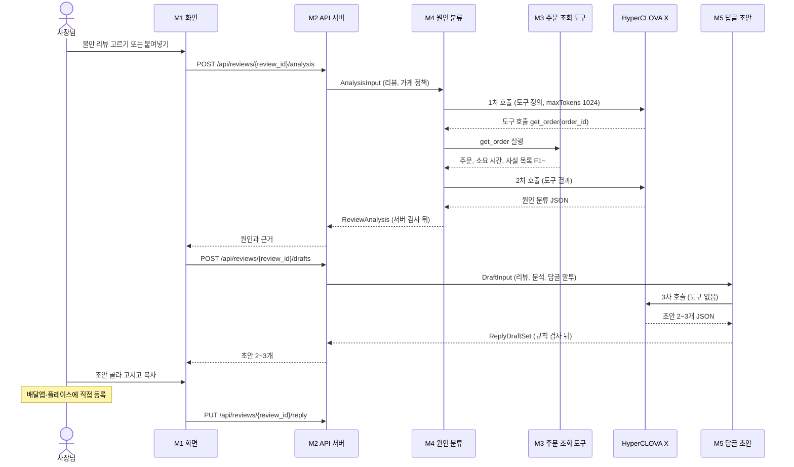

# 모듈 입출력 규격 초안 v0.1

| 항목 | 내용 |
|---|---|
| 상태 | 초안. 11/2 회의에서 방향이 정해지면 v0.2로 고친다 |
| 담당 | 박건영 (이슈 #4) |
| 작성 | 2026-10-30 |
| 근거 | #2 사장님 인터뷰, #3 CLOVA Studio 실험, #5 기존 서비스 조사, 「1차 스프린트 결과 총정리 (10/30)」 4~6절 |
| 아직 반영하지 못한 것 | 10/31 특화교육 질문의 답 (#6), #1 데이터 출처 결과, #5 보완 조사. 바뀔 곳은 11절에 모았다 |

아래 핵심 장면 후보를 기준으로 썼다. 11/2에 장면이 바뀌어도 모듈 경계(입력 → 도구 조회 → 분류 → 초안 → 사람 확인)는 그대로 두고 데이터 필드만 고치면 되게 나눴다.

## 이 문서를 읽는 법

| 맡은 일 | 먼저 볼 곳 |
|---|---|
| 화면 | 2절 흐름, 6절 API, 7절 오류, 8절 mock 모드 |
| 에이전트·function calling | 5.1 분류 기준, 5.2 도구, 5.3 원인 분류, 5.6 LLM 호출 |
| 합성 데이터·도구 | 4절 데이터 형식, 5.2 도구 결과 |
| 답글 초안 | 5.4 |
| 인터뷰·검증, 발표 근거 | 1절, 4.4 정답 라벨, 5.5 최종 답글 기록 |
| 모두 | 아래 "지킬 것", 9·10절 |

> **지킬 것 (모든 모듈)**
> 1. 데이터는 합성 데이터만 쓰고, 손님 개인정보 필드는 두지 않는다 (3.3).
> 2. 네이버 검색 API 결과를 HyperCLOVA X 입력으로 쓰지 않는다. 약관 확인 전이라 이 규격에는 검색 API를 부르는 모듈이 없다.
> 3. function calling 요청은 `maxTokens`를 1024 이상으로 보내고, 추론·이미지 해석과 한 요청에 섞지 않는다 (5.6).
> 4. 답글 자동 등록과 리뷰 자동 수집(크롤링)은 만들지 않는다. 등록은 사장님이 직접 한다.

## 1. 핵심 장면과 범위

### 1.1 핵심 장면 (후보)

1. 불만 리뷰가 들어온다. 사장님이 샘플 리뷰를 고르거나 붙여넣는다. (예: "치킨이 다 식어서 왔어요", 별점 1)
2. 에이전트가 주문 조회 도구를 function calling으로 불러 그 리뷰의 주문을 찾는다.
3. 원인을 가른다: 가게 / 배달·플랫폼 / 요청 사항 불일치 / 판단 보류.
4. 근거가 담긴 답글 초안 2~3개를 만든다. 구성은 사과 + 확인한 사실 + 다음 조치이고, B 사장님이 실제로 쓰는 "사과한 뒤 사실을 담백하게 설명" 방식과 같다.
5. 사장님이 초안을 골라 고친 뒤 배달앱·플레이스에 직접 등록한다. 우리 앱에는 "등록했음"만 남긴다.

### 1.2 범위

| 구분 | 이 규격에 들어간 것 |
|---|---|
| Must | 리뷰 입력(샘플·붙여넣기), 합성 가게·주문·리뷰 데이터, 주문 조회 도구 `get_order`, 원인 분류, 답글 초안 2~3개, 사장님 최종 답글 기록 |
| Should | 주문 번호가 없는 리뷰의 주문 후보 검색 `search_orders`, 여러 채널 리뷰 목록, 가게 원인 불만 주간 요약 |
| Could | LLM 사용량 조회 API |
| 범위 밖 | 답글 자동 등록, 리뷰 자동 수집(크롤링), 네이버 검색 API, 리뷰 사진 분석, 전화 녹음 분석, 실제 POS·배달앱 연동 |

## 2. 주요 흐름



| 단계 | 모듈 | 입력 | 출력 | HyperCLOVA X 호출 |
|---|---|---|---|---|
| ① 리뷰 입력 | M1 → M2 | 붙여넣은 글 또는 샘플 선택 | `Review` (4.3) | 0 |
| ② 주문 조회 | M4 ↔ M3 | `AnalysisInput` (5.3) | `OrderLookupResult` (5.2) | 1 (도구 고르기) |
| ③ 원인 분류 | M4 | 도구 결과 | `ReviewAnalysis` (5.3) | 1 (최종 답) |
| ④ 답글 초안 | M5 | `DraftInput` (5.4) | `ReplyDraftSet` (5.4) | 1 (도구 없음) |
| ⑤ 직접 등록 | 사장님, M1 → M2 | 고친 답글 | `ReplyRecord` (5.5) | 0 |

- 리뷰 하나에 HyperCLOVA X를 3번 부른다. ②③이 function calling 한 흐름이고, ④는 따로 부른다.
- ③과 ④를 나눈 이유
  - Structured Outputs(JSON 형식 강제)는 function calling과 한 요청에 쓸 수 없다.
  - 사장님이 원인을 고치면 초안만 다시 만들 수 있다.
  - 분류가 맞았는지와 답글이 좋은지를 따로 잴 수 있다.
- 숫자 계산(소요 시간, 기준 초과 여부)은 코드(M3)가 한다. 모델은 계산하지 않고, 코드가 만든 사실 목록(`F1`, `F2` …)과 가게 정책(`P1` …)에서 근거를 고른다. 서버는 모델이 댄 근거 ID가 실제로 있는지 검사한다.
- 시간과 토큰은 아직 재지 않았다. #3 실험에서 짧은 질문의 function calling 한 흐름이 2회 호출·355토큰·약 3.3초였고, 리뷰 본문·주문 정보·JSON 출력이 붙으면 늘어난다. 첫 live 실행에서 재서 이 칸을 채운다.
- 모든 모듈은 서버 프로세스 하나 안에서 함수로 잇는다. 이 문서의 JSON은 함수 입출력이자 mock 응답(fixture) 형식이다. 서버를 나누거나 VPC를 묶는 일은 그다음이다.

## 3. 모듈과 공통 규칙

### 3.1 모듈

| ID | 모듈 | 하는 일 | 받는 것 | 주는 것 | 담당 (11/2 확정) |
|---|---|---|---|---|---|
| M1 | 화면 | 리뷰 목록·입력, 원인과 근거 표시, 초안 편집·복사, "등록했어요" 표시 | API 응답 | API 요청 | |
| M2 | API 서버 | 엔드포인트, 입력 검사, 개인정보 가림, M3~M5 연결, 저장 | HTTP 요청 | HTTP 응답 (6·7절) | |
| M3 | 합성 데이터·주문 조회 도구 | 가게·주문·리뷰 합성 데이터, `get_order`·`search_orders` 실행, 소요 시간과 사실 목록 계산 | 도구 인자 | `OrderLookupResult` | |
| M4 | 원인 분류 에이전트 | function calling 진행, 분류 JSON 검사 | `AnalysisInput` | `ReviewAnalysis` | |
| M5 | 답글 초안 | 초안 2~3개 생성, 답글 규칙 검사 | `DraftInput` | `ReplyDraftSet` | |
| M6 | LLM 호출 (공통) | CLOVA Studio 호출, 요청 제약 검사, 재시도, 사용량 기록, mock·replay | `LLMRequest` | `LLMResponse` | |

### 3.2 공통 규칙

- 필드 이름은 `snake_case`이고, 정해진 값(열거값)도 소문자 `snake_case`다 (예: `delivery_platform`). CLOVA Studio 기본 API는 camelCase라서 M6 안에서만 바꿔 쓴다.
- 시각은 ISO 8601에 한국 시간 오프셋을 붙인다: `"2026-11-01T18:30:00+09:00"`. 기간은 분 단위 정수이고 이름이 `_min`으로 끝난다.
- 값이 없으면 필드를 빼지 않고 `null`로 둔다. 목록이면 `[]`.
- ID는 접두사가 붙은 문자열이다: `store_`, `ord_`, `rv_`, `an_`(분석), `ds_`(초안 묶음), `dr_`(초안), `req_`(요청). 근거 ID만 `F1`(주문 사실), `P1`(가게 정책)처럼 쓴다.
- 데이터 레코드에는 모두 `data_origin: "synthetic"`을 붙인다. 화면은 "합성 데이터" 표시를 띄운다 (발표에서도 밝힌다).
- 채널 값: `baemin`, `coupangeats`, `yogiyo`, `naver_place`
- 원인 값: `store`(가게), `delivery_platform`(배달·플랫폼), `request_mismatch`(요청 사항 불일치), `undetermined`(판단 보류)

### 3.3 두지 않는 필드

| 두지 않는 것 | 이유 |
|---|---|
| 손님 이름·닉네임, 손님 ID, 회원 등급, 주문 횟수 | 손님 개인정보다. 답글에서는 "고객님"으로 부른다 |
| 전화번호(안심번호 포함), 주소, 공동현관 번호 | 손님 개인정보다 |
| 배달 요청 사항 ("라이더님께") | 주소·출입 정보가 섞이기 쉽고, 원인 분류에 거의 쓰이지 않는다 |
| 결제 수단·금액 | 분류에 필요 없다 |
| 리뷰 사진 | 사람·영수증이 찍힐 수 있고, 이미지 해석과 function calling은 한 요청에 쓸 수 없다 |
| 라이더 이름·연락처 | 라이더도 개인이다. 배달 원인은 시간 기록으로만 판단한다 |

자유롭게 쓰는 글 필드는 리뷰 본문(`text`)과 가게 요청 사항(`store_request`) 두 개만 둔다. 둘 다 M2가 저장하거나 모델에 보내기 전에 가림 처리를 한다 (9.2).

## 4. 데이터 형식 (M3)

합성 데이터는 `data/synthetic/`에 JSON 파일로 둔다: `store.json`, `orders.json`, `reviews.json`, `labels.json`. 아래 가게·주문·리뷰는 모두 지어낸 것이다.

### 4.1 가게 `Store`

| 필드 | 타입 | 설명 |
|---|---|---|
| `store_id` | string | 가게 ID |
| `name` | string | 가상 가게 이름 |
| `business_type` | string | 업종 (`chicken` 등) |
| `channels` | string[] | 리뷰를 받는 채널 |
| `standard_minutes` | object | 평소 걸리는 시간(분). 아래 다섯 값 |
| `standard_minutes.accept_wait` | integer | 주문 → 접수 |
| `standard_minutes.cooking` | integer | 접수 → 조리 완료 |
| `standard_minutes.pickup_wait` | integer | 조리 완료 → 픽업 |
| `standard_minutes.delivery` | integer | 픽업 → 배달 완료 |
| `standard_minutes.late_margin` | integer | 기준보다 이만큼 넘게 걸리면 "늦음" |
| `policies` | object[] | 가게 정책. 짧아서 도구 대신 모델 입력에 바로 넣는다 |
| `policies[].policy_id` | string | `P1`, `P2` …. 근거로 참조한다 |
| `policies[].topic` | string | `menu_option`, `request_note`, `delivery_delay`, `compensation` |
| `policies[].text` | string | 정책 문장 |
| `reply_style.greeting` | string | 답글 첫 인사 |
| `reply_style.sign_off` | string | 답글 끝맺음 |
| `reply_style.max_chars` | integer | 답글 최대 글자 수. 채널별 제한을 확인하기 전이라 임시로 300 |
| `data_origin` | string | 항상 `synthetic` |

```json
{
  "store_id": "store_bora",
  "name": "보라치킨 (가상)",
  "business_type": "chicken",
  "channels": ["baemin", "coupangeats", "naver_place"],
  "standard_minutes": {
    "accept_wait": 3,
    "cooking": 20,
    "pickup_wait": 5,
    "delivery": 25,
    "late_margin": 10
  },
  "policies": [
    {
      "policy_id": "P1",
      "topic": "menu_option",
      "text": "순살은 메뉴를 고를 때 '순살 변경(+2,000원)' 옵션을 선택해야 바뀐다. 요청 사항에 적은 메뉴 변경은 반영하지 않는다."
    },
    {
      "policy_id": "P2",
      "topic": "compensation",
      "text": "보상·재조리·환불은 사장님이 주문 기록을 보고 직접 정한다."
    }
  ],
  "reply_style": {
    "greeting": "안녕하세요, 보라치킨입니다.",
    "sign_off": "보라치킨 드림",
    "max_chars": 300
  },
  "data_origin": "synthetic"
}
```

- 기준 시간은 임시값이다. 추가 인터뷰에서 평소 조리·배달 시간을 물어 바꾼다.
- 정책이 많아지면(FAQ·안내문) 그때 도구나 RAG로 뺀다.

### 4.2 주문 `Order`

| 필드 | 타입 | 설명 |
|---|---|---|
| `order_id` | string | 주문 ID |
| `store_id` | string | 가게 ID |
| `channel` | string | 주문이 들어온 채널 |
| `delivery_type` | string | `platform_delivery`(플랫폼 배달), `store_delivery`(가게 배달·대행), `pickup`(포장) |
| `status` | string | `delivered`, `cancelled` |
| `ordered_at` | string | 주문 시각 |
| `items` | object[] | 주문 메뉴 |
| `items[].menu_name` | string | 메뉴 이름 |
| `items[].quantity` | integer | 개수 |
| `items[].options` | string[] | 고른 옵션 (예: `["뼈"]`, `["순살 변경"]`) |
| `store_request` | string \| null | 가게 요청 사항 (손님이 가게에 남긴 글) |
| `timeline.accepted_at` | string \| null | 접수 |
| `timeline.ready_at` | string \| null | 조리 완료 |
| `timeline.picked_up_at` | string \| null | 픽업 (포장 주문은 손님 수령) |
| `timeline.delivered_at` | string \| null | 배달 완료 (포장 주문은 `null`) |
| `data_origin` | string | 항상 `synthetic` |

```json
{
  "order_id": "ord_20261101_0042",
  "store_id": "store_bora",
  "channel": "baemin",
  "delivery_type": "platform_delivery",
  "status": "delivered",
  "ordered_at": "2026-11-01T18:30:00+09:00",
  "items": [
    { "menu_name": "후라이드 치킨", "quantity": 1, "options": ["뼈"] },
    { "menu_name": "콜라 1.25L", "quantity": 1, "options": [] }
  ],
  "store_request": "무 많이 주세요",
  "timeline": {
    "accepted_at": "2026-11-01T18:31:00+09:00",
    "ready_at": "2026-11-01T18:52:00+09:00",
    "picked_up_at": "2026-11-01T19:20:00+09:00",
    "delivered_at": "2026-11-01T19:41:00+09:00"
  },
  "data_origin": "synthetic"
}
```

- 실제 배달앱이 사장님에게 어떤 주문 정보를 보여 주는지는 확인 중이다 (#5 보완). 확인되면 필드를 실제 화면에 맞춘다.
- 소요 시간은 저장하지 않고 M3가 조회할 때 계산한다 (5.2).

### 4.3 리뷰 `Review`

| 필드 | 타입 | 설명 |
|---|---|---|
| `review_id` | string | 리뷰 ID |
| `store_id` | string | 가게 ID |
| `channel` | string | 채널 |
| `rating` | integer \| null | 별점 1~5. 별점이 없는 채널은 `null` |
| `text` | string | 리뷰 본문 (1~1,000자) |
| `created_at` | string | 작성 시각 |
| `order_ref` | string \| null | 연결된 주문 ID. 채널이 리뷰와 주문을 이어 주는지 확인하기 전이라 비어 있을 수 있다 |
| `input_method` | string | `sample`(합성 샘플), `paste`(붙여넣기) |
| `pii_masked` | boolean | 서버가 전화번호 같은 패턴을 가렸으면 `true` |
| `status` | string | `new` → `analyzed` → `drafted` → `replied`. 건너뛰면 `skipped` |
| `data_origin` | string | 항상 `synthetic` |

```json
{
  "review_id": "rv_0007",
  "store_id": "store_bora",
  "channel": "baemin",
  "rating": 1,
  "text": "치킨이 다 식어서 왔어요. 다시는 안 시킬 듯",
  "created_at": "2026-11-01T20:05:00+09:00",
  "order_ref": "ord_20261101_0042",
  "input_method": "sample",
  "pii_masked": false,
  "status": "new",
  "data_origin": "synthetic"
}
```

### 4.4 평가용 정답 라벨 `Label`

합성 리뷰를 만들 때 "이 리뷰는 이 원인으로 만들었다"는 정답을 같이 적어 둔다. 모델 입력에는 넣지 않고, 분류 결과와 비교해 맞힌 비율을 잰다. 멘토링 질문 "원인 분류를 평가할 기준"에 대한 우리 쪽 첫 답이기도 하다.

| 필드 | 타입 | 설명 |
|---|---|---|
| `review_id` | string | 리뷰 ID |
| `expected_primary_category` | string | 정답 원인 |
| `expected_order_match` | string | 정답 주문 연결 (5.3의 `order_match` 값) |
| `note` | string | 만든 의도 |

```json
[
  { "review_id": "rv_0007", "expected_primary_category": "delivery_platform", "expected_order_match": "linked", "note": "조리는 제때, 픽업 대기 28분" },
  { "review_id": "rv_0011", "expected_primary_category": "request_mismatch", "expected_order_match": "linked", "note": "뼈 메뉴 + 요청 사항에 순살 변경" },
  { "review_id": "rv_0015", "expected_primary_category": "undetermined", "expected_order_match": "multiple_candidates", "note": "주문 번호 없음, 60분 넘은 주문 2건" }
]
```

- 처음 세트 제안: 원인마다 불만 리뷰 3~5개, 주문 번호가 없는 리뷰 2~3개, 칭찬·일반 리뷰 몇 개. 양과 비율은 11/2 뒤 데이터 담당이 정한다.

## 5. 모듈별 입출력

### 5.1 원인 분류 기준 (M4)

| 값 | 이름 | 이럴 때 고른다 | 주요 근거 | 답글 방향 |
|---|---|---|---|---|
| `store` | 가게 원인 | 조리·포장·맛·양·누락처럼 가게가 바꿀 수 있는 문제. 접수나 조리가 늦었거나 가게가 받아 줄 수 있는 요청을 놓친 경우 | 시간 사실(`accept_wait`, `cooking`), 주문 메뉴, 가게 요청 사항 | 사과 + 확인한 사실 + 가게가 바꿀 것 |
| `delivery_platform` | 배달·플랫폼 원인 | 조리는 기준 안인데 픽업 대기나 배달이 늦은 경우, 플랫폼 기능(쿠폰·결제·주문 전달) 문제 | 시간 사실(`pickup_wait`, `delivery`, `total`) | 사과 + 조리는 제때였다는 사실 + 플랫폼에 전달. 라이더 개인을 탓하지 않는다 |
| `request_mismatch` | 요청 사항 불일치 | 손님의 요청·기대가 주문한 메뉴·옵션이나 가게 정책과 맞지 않는 경우 (예: 뼈 메뉴를 고르고 요청 사항에 "순살로 변경") | 주문 메뉴·옵션, 가게 요청 사항, 정책(`P*`) | 사과 + 메뉴 선택과 요청 사항을 담백하게 설명 + 다음 주문 때 방법 안내 |
| `undetermined` | 판단 보류 | 주문을 못 찾았거나 후보가 여럿, 근거가 서로 맞지 않음, 원인이 섞임, 불만이 분명하지 않음 | `undetermined_reason` | 원인을 단정하지 않고 사과 + 확인하겠다는 말 |

- 늦음 판단은 `value > standard + late_margin`이다. 계산은 M3가 하고 결과를 사실의 `late`에 넣는다.
- 가게가 받아 줄 수 있는 요청을 놓쳤으면 (예: "무 많이 주세요"를 적었는데 무가 적었다는 불만) `request_mismatch`가 아니라 `store`다.
- 맛·양처럼 주문 기록으로 확인할 수 없는 불만은 `store`로 두고 `confidence: "low"`, 근거는 비운다.
- 한 리뷰에 불만이 여럿이면 `issues`에 따로 적는다 (최대 3개). `primary_category`는 리뷰가 가장 크게 문제 삼는 불만의 원인이다. 정하기 어려우면 `undetermined`(`mixed_causes`)로 둔다.

`confidence` 값

| 값 | 뜻 |
|---|---|
| `high` | 근거가 불만을 바로 설명한다 (늦음 표시가 있는 시간, 옵션과 요청의 어긋남) |
| `medium` | 근거가 있지만 간접적이다 |
| `low` | 리뷰 글만으로 판단했다. 근거가 비어 있으면 서버가 `low`로 고친다 |

숫자(0~1) 대신 세 단계로 둔 이유: 모델이 내는 확률 숫자는 실제로 맞는 정도와 잘 맞지 않는다.

`undetermined_reason` 값: `order_not_found`, `multiple_candidates`, `conflicting_evidence`(예: 시간은 모두 정상인데 식었다는 불만), `mixed_causes`, `unclear_complaint`, `no_complaint`(불만이 없는 리뷰)

### 5.2 주문 조회 도구 (M3)

M4가 HyperCLOVA X 요청의 `tools`에 그대로 넣는 정의다. 기본 API(v3)와 OpenAI 호환 API의 `tools` 형식이 같다. 도구는 HTTP가 아니라 서버 안의 함수로 실행한다.

```json
[
  {
    "type": "function",
    "function": {
      "name": "get_order",
      "description": "주문 번호로 주문 한 건을 조회한다. 리뷰에 order_ref가 있을 때 쓴다. 메뉴, 옵션, 가게 요청 사항, 처리 시각과 소요 시간을 사실 목록(F1~)으로 돌려준다.",
      "parameters": {
        "type": "object",
        "properties": {
          "order_id": { "type": "string", "description": "리뷰의 order_ref 값 (예: ord_20261101_0042)" }
        },
        "required": ["order_id"]
      }
    }
  },
  {
    "type": "function",
    "function": {
      "name": "search_orders",
      "description": "리뷰에 주문 번호가 없을 때 리뷰 작성 전에 들어온 같은 채널 주문에서 후보를 찾는다. 리뷰에 나온 메뉴나 걸린 시간으로 좁힌다. 최대 5건을 돌려준다.",
      "parameters": {
        "type": "object",
        "properties": {
          "channel": { "type": "string", "enum": ["baemin", "coupangeats", "yogiyo", "naver_place"], "description": "리뷰 채널" },
          "before": { "type": "string", "description": "이 시각 전에 들어온 주문만 (보통 리뷰 작성 시각, ISO 8601)" },
          "within_hours": { "type": "integer", "description": "before부터 거슬러 올라갈 시간. 기본 48, 최대 72" },
          "menu_keyword": { "type": "string", "description": "리뷰에 나온 메뉴 이름 일부 (예: 양념)" },
          "min_total_min": { "type": "integer", "description": "주문부터 배달 완료까지 이 분보다 오래 걸린 주문만 (예: '한 시간 넘게' → 60)" }
        },
        "required": ["channel", "before"]
      }
    }
  }
]
```

- `get_order`는 Must, `search_orders`는 Should다. 리뷰에 `order_ref`가 늘 있다면 `search_orders`는 빼도 된다 (#5 보완 조사에서 리뷰 옆 주문 정보 확인 중).
- `search_orders`는 모델이 리뷰 글에서 조건을 뽑는 자리다. 예: "한 시간 넘게" → `min_total_min: 60`, "양념이 너무 달아요" → `menu_keyword: "양념"`.

도구 결과 `OrderLookupResult` — 모델에는 이 JSON을 문자열로 바꿔 보낸다 (`tool` 메시지의 `content`는 문자열이어야 한다).

| 필드 | 타입 | 설명 |
|---|---|---|
| `found` | boolean | 주문 한 건을 찾았는지 |
| `match` | string | `linked`(order_ref로 찾음), `searched`(검색으로 한 건), `multiple_candidates`, `not_found` |
| `order` | Order \| null | 찾은 주문 (4.2) |
| `durations_min` | object \| null | `accept_wait`, `cooking`, `pickup_wait`, `delivery`, `total` (분) |
| `facts` | Fact[] | 근거로 쓸 사실 목록 |
| `candidates` | object[] | 후보가 여럿일 때만 채운다. `order_id`, `ordered_at`, `items_text`, `total_min` |

사실 `Fact`

| 필드 | 타입 | 설명 |
|---|---|---|
| `fact_id` | string | `F1`부터. 분석 한 번 안에서 겹치지 않게 매기고, 도구를 두 번 부르면 이어서 매긴다. 가게 정책은 `P1` … 그대로 쓴다 |
| `kind` | string | `item`, `request`, `timeline`, `policy` |
| `key` | string | `items`, `store_request`, `accept_wait`, `cooking`, `pickup_wait`, `delivery`, `total`, 또는 정책 `topic` |
| `text` | string | 사람이 읽는 문장. 화면과 답글에 그대로 옮길 수 있게 쓴다 |
| `value` | integer \| null | 시간 사실의 분 |
| `standard` | integer \| null | 기준 분. `total`은 네 기준의 합 |
| `late` | boolean \| null | 늦음 여부 |

예시 1 — `get_order` 결과 (rv_0007의 주문)

```json
{
  "found": true,
  "match": "linked",
  "order": {
    "order_id": "ord_20261101_0042",
    "store_id": "store_bora",
    "channel": "baemin",
    "delivery_type": "platform_delivery",
    "status": "delivered",
    "ordered_at": "2026-11-01T18:30:00+09:00",
    "items": [
      { "menu_name": "후라이드 치킨", "quantity": 1, "options": ["뼈"] },
      { "menu_name": "콜라 1.25L", "quantity": 1, "options": [] }
    ],
    "store_request": "무 많이 주세요",
    "timeline": {
      "accepted_at": "2026-11-01T18:31:00+09:00",
      "ready_at": "2026-11-01T18:52:00+09:00",
      "picked_up_at": "2026-11-01T19:20:00+09:00",
      "delivered_at": "2026-11-01T19:41:00+09:00"
    },
    "data_origin": "synthetic"
  },
  "durations_min": { "accept_wait": 1, "cooking": 21, "pickup_wait": 28, "delivery": 21, "total": 71 },
  "facts": [
    { "fact_id": "F1", "kind": "item", "key": "items", "text": "주문 메뉴: 후라이드 치킨(뼈) 1개, 콜라 1.25L 1개", "value": null, "standard": null, "late": null },
    { "fact_id": "F2", "kind": "request", "key": "store_request", "text": "가게 요청 사항: 무 많이 주세요", "value": null, "standard": null, "late": null },
    { "fact_id": "F3", "kind": "timeline", "key": "accept_wait", "text": "주문 접수까지 1분 (기준 3분)", "value": 1, "standard": 3, "late": false },
    { "fact_id": "F4", "kind": "timeline", "key": "cooking", "text": "조리 21분 (기준 20분)", "value": 21, "standard": 20, "late": false },
    { "fact_id": "F5", "kind": "timeline", "key": "pickup_wait", "text": "조리 완료 뒤 픽업까지 28분 (기준 5분)", "value": 28, "standard": 5, "late": true },
    { "fact_id": "F6", "kind": "timeline", "key": "delivery", "text": "픽업 뒤 배달 21분 (기준 25분)", "value": 21, "standard": 25, "late": false },
    { "fact_id": "F7", "kind": "timeline", "key": "total", "text": "주문부터 배달 완료까지 71분 (기준 합계 53분)", "value": 71, "standard": 53, "late": true }
  ],
  "candidates": []
}
```

예시 2 — `search_orders` 결과, 후보가 2건 (rv_0015). 모델이 부른 인자:

```json
{ "channel": "baemin", "before": "2026-11-02T13:10:00+09:00", "within_hours": 48, "min_total_min": 60 }
```

```json
{
  "found": false,
  "match": "multiple_candidates",
  "order": null,
  "durations_min": null,
  "facts": [],
  "candidates": [
    { "order_id": "ord_20261102_0008", "ordered_at": "2026-11-02T11:48:00+09:00", "items_text": "양념 치킨(뼈) 1개", "total_min": 66 },
    { "order_id": "ord_20261101_0071", "ordered_at": "2026-11-01T20:15:00+09:00", "items_text": "반반 치킨(순살) 1개, 치즈볼 1개", "total_min": 74 }
  ]
}
```

못 찾았을 때는 `found: false`, `match: "not_found"`, `order: null`, `durations_min: null`, `facts: []`, `candidates: []`이다. 주문을 못 찾는 것은 오류가 아니라 판단 보류의 근거다.

### 5.3 원인 분류 에이전트 (M4)

입력 `AnalysisInput` (M2 → M4)

```json
{
  "review": {
    "review_id": "rv_0007",
    "channel": "baemin",
    "rating": 1,
    "text": "치킨이 다 식어서 왔어요. 다시는 안 시킬 듯",
    "created_at": "2026-11-01T20:05:00+09:00",
    "order_ref": "ord_20261101_0042"
  },
  "store": {
    "store_id": "store_bora",
    "standard_minutes": { "accept_wait": 3, "cooking": 20, "pickup_wait": 5, "delivery": 25, "late_margin": 10 },
    "policies": [
      { "policy_id": "P1", "topic": "menu_option", "text": "순살은 메뉴를 고를 때 '순살 변경(+2,000원)' 옵션을 선택해야 바뀐다. 요청 사항에 적은 메뉴 변경은 반영하지 않는다." },
      { "policy_id": "P2", "topic": "compensation", "text": "보상·재조리·환불은 사장님이 주문 기록을 보고 직접 정한다." }
    ]
  },
  "order_ref_override": null
}
```

- `order_ref_override`: 사장님이 주문 후보에서 하나를 고르면 그 주문 ID. 있으면 리뷰의 `order_ref` 대신 쓴다.
- 모델에 보내는 메시지는 system 1개(분류 규칙, 출력 형식)와 user 1개(위 리뷰와 정책)다. 프롬프트 문장은 규격이 아니라 구현이라 `backend/prompts/`에서 자유롭게 고친다. 규격은 출력 JSON만 고정한다.

진행 순서

1. 1차 호출: `tools`에 5.2 도구, `toolChoice: "auto"`, `maxTokens: 1024`.
2. 모델이 도구를 부르면 M3로 실행하고, 결과를 `tool` 메시지로 붙여 2차 호출을 한다.
3. 모델이 도구를 부르지 않고 바로 답했는데 `order_ref`가 있으면, `toolChoice`로 `get_order`를 지정해 한 번 더 부른다.
4. 한 분석에서 도구는 최대 3번 부른다. 넘으면 `AGENT_STEP_LIMIT` 오류다.
5. 최종 답을 JSON으로 읽고 아래 스키마와 근거 ID를 검사한다. 틀리면 틀린 내용을 붙여 `toolChoice: "none"`으로 한 번 더 요청하고, 또 틀리면 `LLM_OUTPUT_INVALID` 오류다.

- OpenAI 호환 API는 도구를 한 번에 여러 개 부를 수 있다 (`parallel_tool_calls`는 `true`만 된다). 여러 개가 오면 모두 실행해 각각 `tool` 메시지로 돌려준다.

모델 설정 (첫값, 실험하며 조정)

| 항목 | 값 |
|---|---|
| 모델 | `HCX-005` (#3 실험에서 확인). `HCX-007`을 쓰면 추론을 꺼야 한다 (기본 API `thinking.effort: "none"`, OpenAI 호환 `reasoning_effort: "none"`) |
| `maxTokens` | 1024 (function calling 최소값) |
| `temperature` | 0.2 (분류가 흔들리지 않게) |
| 이미지 | 넣지 않는다 |
| Structured Outputs | 쓸 수 없다 (function calling과 한 요청 불가). 프롬프트로 JSON을 요구하고 서버가 검사한다 |

모델이 내는 부분의 스키마 (서버가 검사하는 JSON Schema)

```json
{
  "type": "object",
  "properties": {
    "primary_category": { "type": "string", "enum": ["store", "delivery_platform", "request_mismatch", "undetermined"] },
    "confidence": { "type": "string", "enum": ["high", "medium", "low"] },
    "issues": {
      "type": "array",
      "maxItems": 3,
      "items": {
        "type": "object",
        "properties": {
          "complaint": { "type": "string" },
          "category": { "type": "string", "enum": ["store", "delivery_platform", "request_mismatch", "undetermined"] },
          "evidence": { "type": "array", "items": { "type": "string" } },
          "explanation": { "type": "string" }
        },
        "required": ["complaint", "category", "evidence", "explanation"]
      }
    },
    "undetermined_reason": {
      "type": ["string", "null"],
      "enum": ["order_not_found", "multiple_candidates", "conflicting_evidence", "mixed_causes", "unclear_complaint", "no_complaint", null]
    },
    "owner_checks": { "type": "array", "maxItems": 3, "items": { "type": "string" } }
  },
  "required": ["primary_category", "confidence", "issues", "undetermined_reason", "owner_checks"]
}
```

출력 `ReviewAnalysis` (M4 → M2 → M1)

| 필드 | 타입 | 만드는 곳 | 설명 |
|---|---|---|---|
| `analysis_id` | string | 서버 | 분석 ID |
| `review_id` | string | 서버 | 리뷰 ID |
| `order_id` | string \| null | 서버 | 근거로 쓴 주문 |
| `order_match` | string | 서버 | `linked`, `searched`, `owner_selected`(사장님이 후보에서 고름), `multiple_candidates`, `not_found` |
| `primary_category` | string | 모델 | 대표 원인 |
| `confidence` | string | 모델 (서버 보정) | `high`, `medium`, `low` |
| `issues[].complaint` | string | 모델 | 불만 요약 |
| `issues[].category` | string | 모델 | 이 불만의 원인 |
| `issues[].evidence` | string[] | 모델 (서버 검사) | 근거 ID (`F*`, `P*`) |
| `issues[].explanation` | string | 모델 | 근거로 원인을 설명한 한두 문장 |
| `undetermined_reason` | string \| null | 모델 | 판단 보류일 때만 |
| `owner_checks` | string[] | 모델 | 사장님이 직접 확인하면 좋은 것 (최대 3) |
| `facts` | Fact[] | 서버 | 도구 결과의 사실 + 근거로 쓴 정책 |
| `order_candidates` | object[] | 서버 | 후보가 여럿일 때 화면에서 고르게 한다 |
| `tool_calls` | object[] | 서버 | 부른 도구, 인자, 결과 `match`. 화면의 "에이전트가 한 일"과 디버깅에 쓴다 |
| `model` | string | 서버 | 모델 이름 |
| `usage` | object | 서버 | `llm_calls`, `prompt_tokens`, `completion_tokens`, `total_tokens`, `latency_ms` |
| `mode` | string | 서버 | `mock`, `live`, `replay` |
| `created_at` | string | 서버 | 만든 시각 |

예시 1 — 배달·플랫폼 원인 (mock 응답이라 `usage`가 0이다. live에서는 실제 값이 들어간다)

```json
{
  "analysis_id": "an_rv0007_1",
  "review_id": "rv_0007",
  "order_id": "ord_20261101_0042",
  "order_match": "linked",
  "primary_category": "delivery_platform",
  "confidence": "high",
  "issues": [
    {
      "complaint": "치킨이 식어서 도착함",
      "category": "delivery_platform",
      "evidence": ["F4", "F5", "F7"],
      "explanation": "조리는 21분으로 기준 안이었지만, 조리 완료 뒤 픽업까지 28분을 기다려 전체 71분이 걸렸다."
    }
  ],
  "undetermined_reason": null,
  "owner_checks": ["같은 시간대 다른 주문도 픽업 대기가 길었는지 확인"],
  "facts": [
    { "fact_id": "F1", "kind": "item", "key": "items", "text": "주문 메뉴: 후라이드 치킨(뼈) 1개, 콜라 1.25L 1개", "value": null, "standard": null, "late": null },
    { "fact_id": "F2", "kind": "request", "key": "store_request", "text": "가게 요청 사항: 무 많이 주세요", "value": null, "standard": null, "late": null },
    { "fact_id": "F3", "kind": "timeline", "key": "accept_wait", "text": "주문 접수까지 1분 (기준 3분)", "value": 1, "standard": 3, "late": false },
    { "fact_id": "F4", "kind": "timeline", "key": "cooking", "text": "조리 21분 (기준 20분)", "value": 21, "standard": 20, "late": false },
    { "fact_id": "F5", "kind": "timeline", "key": "pickup_wait", "text": "조리 완료 뒤 픽업까지 28분 (기준 5분)", "value": 28, "standard": 5, "late": true },
    { "fact_id": "F6", "kind": "timeline", "key": "delivery", "text": "픽업 뒤 배달 21분 (기준 25분)", "value": 21, "standard": 25, "late": false },
    { "fact_id": "F7", "kind": "timeline", "key": "total", "text": "주문부터 배달 완료까지 71분 (기준 합계 53분)", "value": 71, "standard": 53, "late": true }
  ],
  "order_candidates": [],
  "tool_calls": [
    { "name": "get_order", "arguments": { "order_id": "ord_20261101_0042" }, "match": "linked" }
  ],
  "model": "HCX-005",
  "usage": { "llm_calls": 0, "prompt_tokens": 0, "completion_tokens": 0, "total_tokens": 0, "latency_ms": 0 },
  "mode": "mock",
  "created_at": "2026-11-01T20:06:10+09:00"
}
```

예시 2 — 요청 사항 불일치. B 사장님이 겪은 상황을 바꿔 만든 합성 사례다 (rv_0011: 쿠팡이츠, 별점 1, "요청 사항에 순살로 바꿔 달라고 적었는데 뼈로 왔어요. 서비스라도 주셔야 하는 거 아닌가요?"). 주문 `ord_20261101_0057`은 뼈 옵션에 요청 사항 "순살로 변경해 주세요"이고 시간은 모두 기준 안이다. 모델이 내는 부분만 적었다.

```json
{
  "primary_category": "request_mismatch",
  "confidence": "high",
  "issues": [
    {
      "complaint": "요청 사항에 적은 순살 변경이 반영되지 않음",
      "category": "request_mismatch",
      "evidence": ["F1", "F2", "P1"],
      "explanation": "주문은 뼈 옵션으로 들어왔고 순살 변경은 요청 사항에만 적혀 있었다. 가게 정책상 순살은 메뉴 옵션으로만 바뀐다."
    }
  ],
  "undetermined_reason": null,
  "owner_checks": ["서비스 요구는 정책 P2대로 사장님이 직접 정하기"]
}
```

이 경우 초안은 사과한 뒤 주문이 뼈 메뉴로 들어왔고 순살은 메뉴 옵션으로만 바뀐다는 것을 담백하게 설명한다. 서비스 요구에는 답하지 않는다 (보상은 사장님이 정한다, P2).

예시 3 — 판단 보류, 주문 후보 2건 (rv_0015: 배민, 별점 2, "주문하고 한 시간 넘게 기다렸어요. 배고파서 혼났네요", `order_ref` 없음). 5.2 예시 2의 검색 결과를 받은 뒤 모델이 내는 부분이다.

```json
{
  "primary_category": "undetermined",
  "confidence": "low",
  "issues": [
    {
      "complaint": "주문 뒤 한 시간 넘게 기다림",
      "category": "undetermined",
      "evidence": [],
      "explanation": "주문 번호가 없고, 리뷰 전 48시간 안에 60분 넘게 걸린 주문이 2건이라 어느 주문인지 정할 수 없다."
    }
  ],
  "undetermined_reason": "multiple_candidates",
  "owner_checks": ["주문 후보 2건 중 이 리뷰의 주문 고르기"]
}
```

화면은 `order_candidates`를 보여 주고, 사장님이 하나를 고르면 `order_ref_override`로 다시 분석한다 (`order_match: "owner_selected"`).

### 5.4 답글 초안 (M5)

입력 `DraftInput` (M2 → M5)

```json
{
  "review": {
    "review_id": "rv_0007",
    "channel": "baemin",
    "rating": 1,
    "text": "치킨이 다 식어서 왔어요. 다시는 안 시킬 듯"
  },
  "analysis": {
    "analysis_id": "an_rv0007_1",
    "primary_category": "delivery_platform",
    "confidence": "high",
    "issues": [
      {
        "complaint": "치킨이 식어서 도착함",
        "category": "delivery_platform",
        "evidence": ["F4", "F5", "F7"],
        "explanation": "조리는 21분으로 기준 안이었지만, 조리 완료 뒤 픽업까지 28분을 기다려 전체 71분이 걸렸다."
      }
    ],
    "facts": [
      { "fact_id": "F1", "kind": "item", "key": "items", "text": "주문 메뉴: 후라이드 치킨(뼈) 1개, 콜라 1.25L 1개", "value": null, "standard": null, "late": null },
      { "fact_id": "F2", "kind": "request", "key": "store_request", "text": "가게 요청 사항: 무 많이 주세요", "value": null, "standard": null, "late": null },
      { "fact_id": "F3", "kind": "timeline", "key": "accept_wait", "text": "주문 접수까지 1분 (기준 3분)", "value": 1, "standard": 3, "late": false },
      { "fact_id": "F4", "kind": "timeline", "key": "cooking", "text": "조리 21분 (기준 20분)", "value": 21, "standard": 20, "late": false },
      { "fact_id": "F5", "kind": "timeline", "key": "pickup_wait", "text": "조리 완료 뒤 픽업까지 28분 (기준 5분)", "value": 28, "standard": 5, "late": true },
      { "fact_id": "F6", "kind": "timeline", "key": "delivery", "text": "픽업 뒤 배달 21분 (기준 25분)", "value": 21, "standard": 25, "late": false },
      { "fact_id": "F7", "kind": "timeline", "key": "total", "text": "주문부터 배달 완료까지 71분 (기준 합계 53분)", "value": 71, "standard": 53, "late": true }
    ]
  },
  "category_override": null,
  "reply_style": { "greeting": "안녕하세요, 보라치킨입니다.", "sign_off": "보라치킨 드림", "max_chars": 300 },
  "count": 3
}
```

- `category_override`: 사장님이 화면에서 원인을 고쳤을 때 그 값. 있으면 분석의 원인 대신 쓴다.
- `count`: 2 또는 3. 2면 아래 표의 앞 두 말투만 만든다.

말투 `style`

| 값 | 화면 이름 | 특징 |
|---|---|---|
| `apology_first` | 사과 먼저 | 사과를 앞에 두고, 사실은 짧게 |
| `fact_first` | 사실 설명 | 확인한 사실을 담백하게 설명 (B 사장님 방식) |
| `short` | 짧게 | 인사·끝맺음 빼고 2~3문장 |

답글 규칙 (프롬프트와 서버 검사의 기준)

1. 구성: `greeting` → 사과 → 확인한 사실 → 다음 조치 → `sign_off`
2. 확인한 사실은 `evidence_refs`로 댄 사실(`F*`, `P*`)에 있는 내용만 쓴다. 사실에 없는 숫자·원인·약속은 쓰지 않는다.
3. 손님을 탓하지 않는다. 배달·플랫폼 원인이어도 라이더 개인을 탓하지 않고 "배달 과정"으로 쓴다.
4. 보상·서비스·환불 약속은 넣지 않는다. 필요하면 사장님이 직접 덧붙인다.
5. 판단 보류면 원인을 단정하지 않는다.
6. 손님 닉네임, 주문 번호, 연락처를 쓰지 않는다. 이모지는 쓰지 않는다 (말투는 11/2 뒤 실제 답글 예시로 맞춘다).

모델이 내는 부분의 스키마. HCX-007 Structured Outputs에도 그대로 넣을 수 있게, 지원되는 키워드(`type`, `properties`, `required`, `enum`, `items`, `minItems`, `maxItems`)만 썼다.

```json
{
  "type": "object",
  "properties": {
    "drafts": {
      "type": "array",
      "minItems": 2,
      "maxItems": 3,
      "items": {
        "type": "object",
        "properties": {
          "style": { "type": "string", "enum": ["apology_first", "fact_first", "short"] },
          "text": { "type": "string" },
          "evidence_refs": { "type": "array", "items": { "type": "string" } },
          "next_action": { "type": "string" }
        },
        "required": ["style", "text", "evidence_refs", "next_action"]
      }
    }
  },
  "required": ["drafts"]
}
```

출력 `ReplyDraftSet` (M5 → M2 → M1)

| 필드 | 타입 | 만드는 곳 | 설명 |
|---|---|---|---|
| `draft_set_id` | string | 서버 | 초안 묶음 ID |
| `review_id` | string | 서버 | 리뷰 ID |
| `analysis_id` | string | 서버 | 바탕이 된 분석 |
| `category_used` | string | 서버 | 초안에 쓴 원인 |
| `category_overridden` | boolean | 서버 | 사장님이 고친 원인을 썼는지 |
| `drafts[].draft_id` | string | 서버 | 초안 ID |
| `drafts[].style` | string | 모델 | 말투 |
| `drafts[].style_label` | string | 서버 | 화면 이름 |
| `drafts[].text` | string | 모델 | 답글 본문 |
| `drafts[].evidence_refs` | string[] | 모델 (서버 검사) | 답글에 쓴 사실 ID |
| `drafts[].next_action` | string | 모델 | 답글에서 약속한 다음 조치 (사장님 할 일) |
| `drafts[].char_count` | integer | 서버 | 공백 포함 글자 수 |
| `drafts[].warnings` | string[] | 서버 | 아래 경고 코드 |
| `model`, `usage`, `mode`, `created_at` | | 서버 | 5.3과 같다 |

경고 `warnings` — 막지 않고 화면에 띄워 사장님이 고치게 한다.

| 코드 | 언제 |
|---|---|
| `over_max_chars` | `char_count`가 `reply_style.max_chars`를 넘음 |
| `number_not_in_evidence` | 답글 속 숫자가 `evidence_refs`의 사실에 없음 |
| `evidence_missing` | 원인이 판단 보류가 아닌데 `evidence_refs`가 비어 있음 |
| `compensation_mentioned` | 보상·서비스·환불·쿠폰 같은 말이 들어감 |
| `pii_pattern` | 전화번호·이메일·URL 모양이 들어감 |

모델 설정 (첫값)

| 항목 | 값 |
|---|---|
| 모델 | `HCX-005`. 프롬프트로 JSON을 요구하고 서버가 검사한다 |
| 대안 | `HCX-007` + Structured Outputs (`responseFormat`, 추론 `none`). JSON 형식을 모델 쪽에서 강제하지만 HCX-007에서만 되고, 우리는 아직 시험하지 않았다 |
| `maxTokens` | 1024에서 시작한다. 잘리면(`finishReason: "length"`) 올린다 |
| `temperature` | 0.5 (말투마다 달라지게) |
| 도구 | 없음 |

예시 — rv_0007 초안 3개 (mock)

```json
{
  "draft_set_id": "ds_rv0007_1",
  "review_id": "rv_0007",
  "analysis_id": "an_rv0007_1",
  "category_used": "delivery_platform",
  "category_overridden": false,
  "drafts": [
    {
      "draft_id": "dr_rv0007_1_a",
      "style": "apology_first",
      "style_label": "사과 먼저",
      "text": "안녕하세요, 보라치킨입니다. 따뜻하게 드셔야 할 치킨이 식어서 도착해 정말 죄송합니다. 확인해 보니 조리는 21분 만에 끝났지만, 배달이 출발하기까지 28분이 더 걸렸습니다. 이 상황은 배달 플랫폼에 전달하겠습니다. 다음에는 따뜻한 치킨으로 찾아뵙겠습니다. 보라치킨 드림",
      "evidence_refs": ["F4", "F5"],
      "next_action": "배달 지연 건을 배민 고객센터에 전달",
      "char_count": 151,
      "warnings": []
    },
    {
      "draft_id": "dr_rv0007_1_b",
      "style": "fact_first",
      "style_label": "사실 설명",
      "text": "안녕하세요, 보라치킨입니다. 식은 치킨을 받으셔서 속상하셨을 것 같아 죄송합니다. 주문 기록을 확인해 보니 조리는 기준 시간 안에 끝났지만, 조리 완료 뒤 배달이 출발하기까지 28분이 걸려 도착까지 모두 71분이 지났습니다. 배달 과정에서 늦어진 부분은 플랫폼에 전달하고, 포장도 한 번 더 점검하겠습니다. 보라치킨 드림",
      "evidence_refs": ["F4", "F5", "F7"],
      "next_action": "배달 지연 건을 플랫폼에 전달하고 포장 점검",
      "char_count": 179,
      "warnings": []
    },
    {
      "draft_id": "dr_rv0007_1_c",
      "style": "short",
      "style_label": "짧게",
      "text": "안녕하세요, 보라치킨입니다. 식은 치킨을 드시게 해 죄송합니다. 조리 뒤 배달 출발까지 28분이 걸린 것을 확인했고, 플랫폼에 전달하겠습니다. 보라치킨 드림",
      "evidence_refs": ["F5"],
      "next_action": "배달 지연 건을 플랫폼에 전달",
      "char_count": 87,
      "warnings": []
    }
  ],
  "model": "HCX-005",
  "usage": { "llm_calls": 0, "prompt_tokens": 0, "completion_tokens": 0, "total_tokens": 0, "latency_ms": 0 },
  "mode": "mock",
  "created_at": "2026-11-01T20:06:20+09:00"
}
```

### 5.5 사장님 최종 답글 `ReplyRecord`

사장님이 초안을 고쳐 배달앱·플레이스에 직접 등록한 뒤 "등록했어요"를 누르면 저장한다. 우리 앱은 답글을 어디에도 올리지 않는다.

요청 (M1 → M2)

| 필드 | 타입 | 설명 |
|---|---|---|
| `draft_id` | string \| null | 고른 초안. 처음부터 직접 썼으면 `null` |
| `final_text` | string | 사장님이 고친 최종 답글 |
| `category_confirmed` | string | 사장님이 확인한 원인 (분석과 다르면 고친 값) |
| `registered_by_owner` | boolean | 사장님이 직접 등록했다고 표시 |
| `elapsed_seconds` | integer \| null | 리뷰를 연 때부터 "등록했어요"까지 걸린 초. 시연·인터뷰 때 시간 재기에 쓴다 |

```json
{
  "draft_id": "dr_rv0007_1_b",
  "final_text": "안녕하세요, 보라치킨입니다. 식은 치킨을 받으셔서 속상하셨을 것 같아 죄송합니다. 주문 기록을 확인해 보니 조리는 기준 시간 안에 끝났지만, 조리 완료 뒤 배달이 출발하기까지 28분이 걸려 도착까지 모두 71분이 지났습니다. 배달 과정에서 늦어진 부분은 플랫폼에 전달하고, 포장도 한 번 더 꼼꼼히 점검하겠습니다. 보라치킨 드림",
  "category_confirmed": "delivery_platform",
  "registered_by_owner": true,
  "elapsed_seconds": 95
}
```

응답

| 필드 | 타입 | 설명 |
|---|---|---|
| `review_id` | string | 리뷰 ID |
| `status` | string | `replied` |
| `reply.draft_id`, `reply.final_text`, `reply.category_confirmed`, `reply.registered_by_owner`, `reply.elapsed_seconds` | | 요청 값 |
| `reply.category_model` | string | 모델이 낸 원인. `category_confirmed`와 비교하면 분류 정확도가 나온다 |
| `reply.edit_ratio` | number | 0~1. 초안에서 얼마나 고쳤는지. `1 - SequenceMatcher(None, 초안, 최종).ratio()` (Python `difflib`), 소수 둘째 자리 |
| `reply.replied_at` | string | 저장 시각 |

```json
{
  "review_id": "rv_0007",
  "status": "replied",
  "reply": {
    "draft_id": "dr_rv0007_1_b",
    "final_text": "안녕하세요, 보라치킨입니다. 식은 치킨을 받으셔서 속상하셨을 것 같아 죄송합니다. 주문 기록을 확인해 보니 조리는 기준 시간 안에 끝났지만, 조리 완료 뒤 배달이 출발하기까지 28분이 걸려 도착까지 모두 71분이 지났습니다. 배달 과정에서 늦어진 부분은 플랫폼에 전달하고, 포장도 한 번 더 꼼꼼히 점검하겠습니다. 보라치킨 드림",
    "category_model": "delivery_platform",
    "category_confirmed": "delivery_platform",
    "edit_ratio": 0.01,
    "registered_by_owner": true,
    "elapsed_seconds": 95,
    "replied_at": "2026-11-01T20:08:00+09:00"
  }
}
```

`category_model`과 `category_confirmed`, `edit_ratio`, `elapsed_seconds`는 발표의 "데이터 기반 의사결정" 근거로 쓴다 (분류가 얼마나 맞았는지, 초안을 얼마나 고쳤는지, 얼마나 걸렸는지).

### 5.6 LLM 호출 (M6)

M4·M5는 CLOVA Studio를 직접 부르지 않고 M6만 거친다. 그래야 제약 검사, mock·replay, 사용량 기록을 한곳에서 한다.

`LLMRequest`

| 필드 | 타입 | 설명 |
|---|---|---|
| `purpose` | string | `analysis`, `analysis_retry`, `drafts` (사용량 집계용) |
| `model` | string | `HCX-005` 등 |
| `messages` | object[] | `role`(`system`·`user`·`assistant`·`tool`), `content`, `tool_calls`, `tool_call_id`. system은 1개만 |
| `tools` | object[] \| null | 5.2 도구 정의 |
| `tool_choice` | string \| object \| null | `auto`, `none`, `{"type": "function", "function": {"name": "get_order"}}` |
| `max_tokens` | integer | `tools`가 있으면 1024 이상 |
| `temperature` | number | 0~1 |
| `response_schema` | object \| null | Structured Outputs용 (HCX-007만) |
| `reasoning` | string \| null | HCX-007 추론 세기. `tools`나 `response_schema`가 있으면 `none`만 된다 |

`LLMResponse`

| 필드 | 타입 | 설명 |
|---|---|---|
| `content` | string \| null | 모델 글 |
| `tool_calls` | object[] | `id`, `name`, `arguments`. `arguments`는 항상 객체로 바꿔 준다 (기본 API는 객체로 오고, OpenAI 호환은 문자열로 올 수 있다) |
| `finish_reason` | string | `stop`, `tool_calls`, `length` |
| `usage` | object | `prompt_tokens`, `completion_tokens`, `total_tokens` |
| `latency_ms` | integer | 걸린 시간 |
| `upstream_request_id` | string \| null | CLOVA Studio 요청 ID (`X-NCP-CLOVASTUDIO-REQUEST-ID`) |

보내기 전에 M6가 막는 요청 — API를 부르지 않고 바로 오류를 낸다. 서버 로그에 남기고 화면에는 `INTERNAL_ERROR`로 보인다.

- `tools`가 있는데 `max_tokens`가 1024보다 작다 (#3 실험의 첫 400 오류가 이것이었다)
- `tools`와 `response_schema`를 같이 보낸다
- `tools`나 `response_schema`가 있는데 `reasoning`이 `none`이 아니다
- 이미지가 든 메시지가 있다 (이 규격에는 이미지 입력이 없다)
- system 메시지가 2개 이상이다

API 형식 차이 (M6 안에서만 신경 쓴다)

| | 기본 API (v3) | OpenAI 호환 API |
|---|---|---|
| 주소 | `https://clovastudio.stream.ntruss.com/v3/chat-completions/{모델}` | `https://clovastudio.stream.ntruss.com/v1/openai` + `/chat/completions` |
| 필드 이름 | camelCase (`maxTokens`, `toolChoice`, `toolCalls`) | snake_case (`max_tokens`, `tool_choice`, `tool_calls`) |
| 도구 인자 | 객체 | 문자열일 수 있다 (OpenAI 형식) |
| 도구 결과 메시지 | `role: "tool"`, `toolCallId`, `content`(문자열) | `role: "tool"`, `tool_call_id`, `content`(문자열) |
| 인증 | `Authorization: Bearer {API 키}` | 같은 CLOVA Studio API 키 (OpenAI SDK의 `api_key`) |

#3 실험은 OpenAI 호환 형식으로 성공했다. 어느 쪽으로 갈지는 올라올 실험 코드를 보고 정한다.

재시도와 시간 제한

- 429: 잠깐 기다렸다 1번 재시도하고, 또 429면 `LLM_RATE_LIMITED`
- 5xx·시간 초과: 1번 재시도
- 400·401·403: 재시도하지 않는다 (요청이나 키 문제)
- 호출 한 번 20초, 분석 한 번(호출 2~3회) 전체 45초를 넘기면 `LLM_TIMEOUT`

사용량 기록 — 호출마다 `logs/llm_usage.jsonl`에 한 줄씩 남긴다. 프롬프트·응답 글은 남기지 않는다.

| 필드 | 설명 |
|---|---|
| `ts` | 호출 시각 |
| `purpose` | `analysis` 등 |
| `model`, `mode` | 모델, 실행 모드 |
| `http_status`, `status` | HTTP 상태, `ok` 또는 오류 코드 |
| `prompt_tokens`, `completion_tokens`, `total_tokens`, `latency_ms` | 사용량 |
| `review_id` | 어느 리뷰 때문에 불렀는지 |

이용량 한도 참고 (조사 노트 기준 2025-07-17, 바뀌었을 수 있다): HCX-005 테스트 앱은 분당 60회·6만 토큰이고 메인 계정 기준으로 합산된다. 분당 토큰에는 입력 토큰과 `maxTokens` 설정값이 같이 잡혀서, function calling의 1024가 한도를 빨리 쓴다. 팀이 한 키를 같이 쓰면 한도도 같이 쓴다.

### 5.7 주간 요약 (Should)

가게 원인 불만을 주 단위로 묶어 사장님 할 일로 보여 준다. 묶는 방법(규칙 또는 모델)은 11/2 뒤에 정하고, 출력 형식만 먼저 둔다. 아래 숫자는 형식 예시다.

```json
{
  "store_id": "store_bora",
  "week_start": "2026-11-02",
  "week_end": "2026-11-08",
  "review_count": 52,
  "complaint_count": 9,
  "by_category": { "store": 3, "delivery_platform": 4, "request_mismatch": 1, "undetermined": 1 },
  "store_issues": [
    { "theme": "조리 지연", "count": 2, "review_ids": ["rv_0102", "rv_0110"], "suggested_todo": "금요일 저녁 조리 인원 점검" },
    { "theme": "소스 누락", "count": 1, "review_ids": ["rv_0121"], "suggested_todo": "포장 전 소스 확인 순서 추가" }
  ],
  "category_source": "owner_confirmed_first",
  "generated_at": "2026-11-09T09:00:00+09:00"
}
```

- 원인은 사장님이 확인한 값(`category_confirmed`)을 먼저 쓰고, 없으면 모델 값을 쓴다 (`category_source`).

## 6. API 엔드포인트 (M2)

공통

- 로컬 기본 주소는 `http://localhost:8000` (임시), 경로는 모두 `/api`로 시작한다.
- 요청·응답은 `application/json; charset=utf-8`
- 모든 응답에 `X-Request-Id` 헤더(`req_...`)를 붙이고, 오류 본문에도 같은 값을 넣는다.
- 인증은 없다 (로컬 데모). 외부에 띄울 때는 `X-Access-Token` 헤더를 검사한다 (9.1).
- 목록 응답은 `{ "items": [...], "count": n }`

| # | 메서드 | 경로 | 하는 일 | 응답 | 우선 |
|---|---|---|---|---|---|
| 1 | GET | `/api/health` | 상태, 실행 모드, 규격 버전 | 아래 | Must |
| 2 | GET | `/api/store` | 가상 가게 정보·정책·답글 말투 | `Store` | Must |
| 3 | GET | `/api/reviews` | 리뷰 목록. 쿼리 `channel`, `status`, `max_rating`, `limit`(기본 50) | 목록 | Must (여러 채널은 Should) |
| 4 | POST | `/api/reviews` | 붙여넣은 리뷰 등록 | `Review` (201) | Must |
| 5 | GET | `/api/reviews/{review_id}` | 리뷰와 최근 분석·초안·최종 답글 | 아래 | Must |
| 6 | POST | `/api/reviews/{review_id}/analysis` | 주문 조회 + 원인 분류 | `ReviewAnalysis` | Must |
| 7 | POST | `/api/reviews/{review_id}/drafts` | 답글 초안 2~3개 | `ReplyDraftSet` | Must |
| 8 | PUT | `/api/reviews/{review_id}/reply` | 최종 답글과 직접 등록 표시 | `ReplyRecord` | Must |
| 9 | GET | `/api/orders/{order_id}` | 주문 한 건과 사실 목록 (근거 펼쳐 보기) | `OrderLookupResult` | Should |
| 10 | GET | `/api/summary/weekly` | 주간 요약. 쿼리 `week_start`(월요일 날짜) | 5.7 | Should |
| 11 | GET | `/api/usage` | LLM 호출 수·토큰 합계 (`since`, `llm_calls`, `total_tokens`, `by_purpose`) | | Could |

- `max_rating`: 이 별점 이하만 보여 준다. 별점이 없는(`null`) 리뷰는 함께 보여 준다.

`GET /api/health`

```json
{
  "status": "ok",
  "mode": "mock",
  "spec_version": "0.1",
  "models": { "analysis": "HCX-005", "drafts": "HCX-005" },
  "data_origin": "synthetic"
}
```

`POST /api/reviews` — 요청. `text`는 1~1,000자, `created_at`이 없으면 서버 시각을 쓴다.

```json
{
  "channel": "coupangeats",
  "rating": 2,
  "text": "배달이 늦어서 가게에 전화했는데 안 받으셨어요. 010-0000-0000으로 연락 주세요",
  "created_at": "2026-11-01T21:10:00+09:00",
  "order_ref": null
}
```

응답 (201). 전화번호가 가려졌고, 가리기 전 원문은 저장하지 않는다.

```json
{
  "review_id": "rv_0101",
  "store_id": "store_bora",
  "channel": "coupangeats",
  "rating": 2,
  "text": "배달이 늦어서 가게에 전화했는데 안 받으셨어요. [가림]으로 연락 주세요",
  "created_at": "2026-11-01T21:10:00+09:00",
  "order_ref": null,
  "input_method": "paste",
  "pii_masked": true,
  "status": "new",
  "data_origin": "synthetic"
}
```

`GET /api/reviews/{review_id}` — 아직 분석하지 않은 리뷰

```json
{
  "review": {
    "review_id": "rv_0007",
    "store_id": "store_bora",
    "channel": "baemin",
    "rating": 1,
    "text": "치킨이 다 식어서 왔어요. 다시는 안 시킬 듯",
    "created_at": "2026-11-01T20:05:00+09:00",
    "order_ref": "ord_20261101_0042",
    "input_method": "sample",
    "pii_masked": false,
    "status": "new",
    "data_origin": "synthetic"
  },
  "analysis": null,
  "draft_set": null,
  "reply": null
}
```

`POST /api/reviews/{review_id}/analysis` — 요청 본문은 비워도 된다. 응답은 5.3 예시 1.

```json
{ "order_ref_override": null }
```

`POST /api/reviews/{review_id}/drafts` — 요청. 응답은 5.4 예시. 분석이 없으면 `409 ANALYSIS_REQUIRED`

```json
{ "count": 3, "category_override": null }
```

`PUT /api/reviews/{review_id}/reply` — 요청·응답은 5.5

화면이 쓰는 필드 (M1 확인용)

| 화면 요소 | 쓰는 필드 |
|---|---|
| 리뷰 목록 | `channel`, `rating`, `text`, `created_at`, `status`, `data_origin` |
| 원인 표시 | `primary_category`, `confidence`, `issues[].complaint`, `issues[].explanation` |
| 근거 | `issues[].evidence` → `facts[].text` (`late: true`는 강조) |
| 에이전트가 한 일 | `tool_calls[].name`, `tool_calls[].match` |
| 주문 후보 고르기 | `order_candidates` → 분석 다시 요청 (`order_ref_override`) |
| 사장님 확인할 것 | `owner_checks` |
| 초안 탭 | `drafts[].style_label`, `text`, `char_count`, `warnings` |
| 초안 속 근거 | `drafts[].evidence_refs` → `facts` |
| 등록했어요 | `PUT /reply` (`final_text`, `category_confirmed`, `elapsed_seconds`) |

## 7. 오류 응답 형식

```json
{
  "error": {
    "code": "LLM_RATE_LIMITED",
    "message": "HyperCLOVA X 호출 한도를 넘었습니다. 잠시 뒤 다시 시도해 주세요.",
    "retryable": true,
    "details": { "upstream_status": 429 },
    "request_id": "req_7f3a9c"
  }
}
```

| HTTP | `code` | 언제 | `retryable` | 화면 |
|---|---|---|---|---|
| 400 | `VALIDATION_ERROR` | 필드 누락·형식 오류. `details.fields`에 필드별 이유 | false | 입력 칸 옆에 표시 |
| 404 | `REVIEW_NOT_FOUND` | 없는 `review_id` | false | 목록으로 |
| 404 | `ORDER_NOT_FOUND` | `/api/orders/{order_id}`에서 없는 주문 | false | "주문 기록 없음" |
| 409 | `ANALYSIS_REQUIRED` | 분석 전에 초안을 요청함 | false | 분석부터 |
| 429 | `LLM_RATE_LIMITED` | CLOVA Studio 429 (재시도 뒤에도) | true | 잠시 뒤 다시 |
| 502 | `LLM_UPSTREAM_ERROR` | CLOVA Studio 4xx·5xx. `details.upstream_status` | 5xx만 true | 다시 시도, 데모 때는 replay |
| 502 | `LLM_OUTPUT_INVALID` | 모델 출력이 규격 JSON이 아님 (재요청 뒤에도) | true | 다시 시도 |
| 502 | `AGENT_STEP_LIMIT` | 도구 호출이 3번을 넘음 | true | 다시 시도 |
| 504 | `LLM_TIMEOUT` | 시간 제한을 넘음 | true | 다시 시도 |
| 500 | `INTERNAL_ERROR` | 그 밖의 서버 오류, M6가 막은 요청 | false | 담당에게 `request_id` 전달 |

오류가 아닌 것 (200으로 돌려준다)

- 주문을 못 찾았거나 후보가 여럿 → `undetermined` 분석 결과
- 붙여넣은 글에서 전화번호 등을 가림 → `pii_masked: true`
- 초안이 규칙을 어겼을 수 있음 → `warnings`

## 8. 실행 모드

| `APP_MODE` | 하는 일 | 쓰는 때 |
|---|---|---|
| `mock` | M6가 모델을 부르지 않고 `fixtures/`의 고정 응답을 돌려준다. M3 도구는 실제로 돈다 | 화면 개발, 자동 테스트, 키가 없는 팀원 |
| `live` | 실제 HyperCLOVA X 호출 | 프롬프트·분류 실험, 시간·토큰 재기 |
| `replay` | live 때 저장한 응답을 같은 요청에 다시 돌려준다 | 발표 데모 백업 (네트워크·한도 문제 대비) |

- mock 응답의 첫 버전이 이 문서 5장 예시다. `fixtures/{review_id}.{purpose}.json`으로 둔다 (예: `rv_0007.analysis.json`).
- replay 응답은 `data/replay/`에 둔다. 합성 데이터로 만든 응답이라 저장소에 올려도 된다.
- live 호출은 #3 실험 때처럼 사용량 담당(박건영)에게 먼저 알린다. 팀 크레딧 계정이 정해지기 전(10/31 질문)에는 횟수를 작게 잡는다.

## 9. API 키·개인정보 관리

### 9.1 API 키

키는 `.env`에만 둔다. `.env`는 저장소에 올리지 않고, 변수 이름만 적은 `.env.example`을 올린다.

```dotenv
# 실행 모드: mock | live | replay
APP_MODE=mock

# CLOVA Studio. 키는 .env에만 적는다
CLOVASTUDIO_API_KEY=
# openai(OpenAI 호환) 또는 v3(기본 API)
CLOVASTUDIO_API_STYLE=openai
CLOVASTUDIO_BASE_URL=https://clovastudio.stream.ntruss.com/v1/openai
LLM_MODEL_ANALYSIS=HCX-005
LLM_MODEL_DRAFTS=HCX-005
# function calling은 1024 이상
LLM_MAX_TOKENS_TOOLS=1024
LLM_TIMEOUT_SECONDS=20

# 데이터
DATA_DIR=./data/synthetic

# 외부에 띄울 때만. 화면이 X-Access-Token 헤더로 보낸다
APP_ACCESS_TOKEN=
```

- 키를 카톡·이슈·PR·코드·스크린샷에 붙이지 않는다. 실수로 올렸으면 커밋을 지우기보다 먼저 CLOVA Studio에서 그 키를 폐기하고 새로 받은 뒤 박건영에게 알린다.
- 자동 테스트(CI)는 mock 모드라 키가 필요 없다. live 키가 필요한 곳은 데모 서버뿐이고, 서버의 `.env` 또는 GitHub 저장소 비밀값(Settings → Secrets and variables → Actions)에 박건영이 넣는다.
- 어느 계정의 키를 쓸지는 팀 크레딧 계정이 정해지면(10/31 질문) 정한다. 테스트 앱 키와 서비스 앱 키는 한도가 따로라서, 데모용 서비스 앱 키를 따로 받는 방안도 같이 본다.
- 외부에 띄울 때는 `APP_ACCESS_TOKEN`을 정해 아무나 live 호출로 크레딧을 쓰지 못하게 한다.

### 9.2 개인정보

- 데이터 형식에 손님 개인정보 필드가 없다 (3.3). 필드를 늘릴 때도 이 표를 먼저 본다.
- 합성 데이터를 만들 때
  - 실제 상호·지점명·주소·사람 이름을 쓰지 않는다.
  - 리뷰 글과 요청 사항에 전화번호·주소·닉네임을 넣지 않는다.
  - 인터뷰 원문을 옮기지 않고 상황만 빌려 다시 쓴다 (예: rv_0011).
- 붙여넣은 리뷰: M2가 저장하거나 모델에 보내기 전에 전화번호·이메일·URL 모양을 `[가림]`으로 바꾸고 `pii_masked: true`로 둔다. CLOVA Studio도 전화번호·이메일·URL을 가리지만 거기에 기대지 않는다.
- 대회 동안에는 붙여넣기에도 합성 리뷰만 쓴다. 실제 리뷰(A 사장님 동의 리뷰 등)를 쓸지는 11/2에 정하고, 쓰게 되면 저장소 밖 비공개 폴더에 두는 규칙을 따로 만든다.
- 로그: 사용량 로그에는 글을 남기지 않는다. 프롬프트·응답 원문 로그는 각자 컴퓨터의 `logs/`에만 두고 저장소·이슈에 올리지 않는다.
- 이슈·PR에는 합성 데이터만 올린다. 실제 리뷰·주문·매출 원본과 네이버 검색 API 원본 결과는 올리지 않는다 (스프린트 공통 안내와 같다).
- 네이버 검색 API: 어떤 모듈도 부르지 않고 도구 목록에도 없다. 대회에서 써도 된다는 답을 글로 받으면(#1, #6) 규격 변경 PR로 도구를 더한다.

### 9.3 `.gitignore`

첫 코드 PR에 넣는다.

```gitignore
.env
.env.*
!.env.example
logs/
data/private/
__pycache__/
node_modules/
```

## 10. 브랜치 규칙과 코드 합치기

- `main`은 언제나 데모가 돌아가는 상태로 둔다. `main`에 직접 push하지 않고 PR로만 합친다.
- 이 저장소에서는 브랜치 보호 규칙을 켤 수 없다. 비공개 저장소라 GitHub API가 "Upgrade to GitHub Pro or make this repository public"(403)을 돌려줬다 (10/30 확인). 그래서 아래 규칙은 약속으로 지킨다.

| 항목 | 규칙 | 예 |
|---|---|---|
| 브랜치 이름 | `종류/이슈번호-짧은-설명` (영문 소문자·하이픈) | `docs/4-module-io-spec`, `exp/3-clova-fc` |
| 종류 | `feat` 기능, `fix` 버그, `docs` 문서, `data` 합성 데이터, `exp` 실험, `chore` 설정 | |
| 커밋 메시지 | `종류: 한 줄 요약 (#이슈)` | `docs: 모듈 입출력 규격 초안 v0.1 (#4)` |
| PR 본문 | 무엇을 했는지, 어떻게 확인했는지, 규격 변경 여부. 이슈를 끝내면 `Closes #번호`, 일부면 `Refs #번호` | |
| 리뷰 | 1명 이상 확인한 뒤 합친다 | |
| 합치는 담당 | 박건영 (제안, 11/2 확정). 하루 넘게 비우면 리뷰한 사람이 합친다 | |
| 합치는 방식 | Squash and merge, 합친 뒤 브랜치 삭제 | |
| 규격 변경 | 코드보다 이 문서를 먼저 PR로 고치고, 영향받는 모듈 담당을 리뷰어로 넣는다. 버전을 올리고 변경 기록에 적는다 | |
| 동결 | 11/18 `demo-v1` 태그. 그 뒤 `main`에는 버그 수정만 | |

- 저장소 설정의 "Automatically delete head branches"가 꺼져 있다. 켜면 합친 브랜치가 자동으로 지워진다.
- 실험 코드(#3)는 `exp/` 브랜치나 `experiments/` 폴더로 합친다. `main`의 데모를 깨지 않으면 된다.

폴더 구조 제안 (언어·프레임워크는 11/2 역할을 정할 때 확정, 실험 코드는 Python)

```text
docs/              규격·설계 문서 (이 문서)
backend/           M2 API 서버
  agent/           M4 원인 분류
  drafts/          M5 답글 초안
  llm/             M6 LLM 호출
  tools/           M3 주문 조회 도구
  prompts/         system 프롬프트
frontend/          M1 화면
data/synthetic/    합성 데이터 (store, orders, reviews, labels)
data/replay/       replay 모드 응답
fixtures/          mock 모드 응답 (5장 예시)
experiments/       실험 코드 (#3 등)
```

## 11. 11/2 회의 뒤 고칠 곳

| 정할 것 | 이 초안의 가정 | 바뀌면 고칠 곳 |
|---|---|---|
| 사용자·업종 | 배달 비중이 높은 치킨집 사장님 | 4.1 가게 예시, 4.2 메뉴, 5.4 말투 |
| 핵심 장면 | 불만 리뷰 → 주문 조회 → 원인 분류 → 초안 → 직접 등록 | 1·2절 흐름. 모듈 경계는 두고 도구·데이터만 바꾼다 |
| MoSCoW | Must: 입력·주문 조회·분류·초안·기록 | 1.2, 6절 우선순위 |
| 데이터 방침 | 합성 데이터만 | 3.2 `data_origin`, 4.3 `input_method`, 9.2 |
| 역할 | 담당 칸 비움 | 3.1 표, 10절 합치는 담당 |
| 원인 범주 | 네 가지 | 3.2, 5.1, 5.3 스키마 |

다른 결과를 기다리는 것

| 기다리는 것 | 지금 가정 | 바뀌면 |
|---|---|---|
| 10/31: 네이버 밖 리뷰를 중심에 둬도 되는지 | 배민·쿠팡이츠 중심, `naver_place` 포함 | 채널 값, 샘플 비율 |
| 10/31: 검색 API 결과를 HyperCLOVA X에 써도 되는지 | 쓰지 않음 | 쓸 수 있다는 글로 된 답을 받으면 도구 추가 (규격 변경 PR) |
| 10/31: 크레딧 계정과 과금 | 정해지지 않음 | 9.1 키 관리, live 호출 횟수 |
| 10/31: 합성 데이터 시연을 심사에서 어떻게 보는지 | 합성임을 화면·발표에서 밝힘 | `data_origin` 표시 방식 |
| #5: 배달앱이 리뷰 옆에 주문 정보를 보여 주는지 | 모름. `order_ref`가 비어도 되게 하고 `search_orders`를 둠 | 4.3 `order_ref`, 5.2 `search_orders` 우선순위 |
| #5: 실제 주문 화면의 항목 | 접수·조리 완료·픽업·배달 완료 시각이 있다고 가정 | 4.2 `timeline` |
| B 사장님 추가 질문 (불만 리뷰 때 보는 정보와 걸리는 시간) | 기준 시간은 임시값 | 4.1 `standard_minutes` |
| 실험: HCX-005로 분류 JSON 실측 | 리뷰당 3회 호출, 시간·토큰은 재지 않음 | 2절 표, 5.6 설정 |
| 실험: HCX-007 Structured Outputs | 시험 전 | 5.4 모델 설정 |
| 채널별 답글 글자 수 제한 | 임시 300자 | 4.1 `max_chars` |

## 변경 기록

| 버전 | 날짜 | 내용 |
|---|---|---|
| 0.1 | 2026-10-30 | 첫 초안. 1차 스프린트 결과(#2, #3, #5)와 핵심 장면 후보 기준 |

## 출처

- 이슈: [#2 사장님 인터뷰](https://github.com/teletubby-aiic-2026/local-business-ai-assistant/issues/2) · [#3 CLOVA Studio 실험](https://github.com/teletubby-aiic-2026/local-business-ai-assistant/issues/3) · [#4 이 규격](https://github.com/teletubby-aiic-2026/local-business-ai-assistant/issues/4) · [#5 기존 서비스 조사](https://github.com/teletubby-aiic-2026/local-business-ai-assistant/issues/5) · [#6 10/31 질문](https://github.com/teletubby-aiic-2026/local-business-ai-assistant/issues/6)
- 팀 노트: 「1차 스프린트 결과 총정리 (10/30)」 4~6절 (팀장 Obsidian 볼트)
- CLOVA Studio [Function calling](https://api.ncloud-docs.com/docs/clovastudio-chatcompletionsv3-fc): `maxTokens` 1024 이상, 추론·이미지 해석과 동시 요청 불가, 도구 결과 `content`는 문자열, system 메시지는 1개
- CLOVA Studio [Structured Outputs](https://api.ncloud-docs.com/docs/clovastudio-chatcompletionsv3-so): HCX-007만, function calling·추론과 동시 요청 불가, `pattern` 미지원
- CLOVA Studio [OpenAI 호환 API](https://api.ncloud-docs.com/docs/clovastudio-openaicompatibility): base URL, snake_case, `parallel_tool_calls`는 `true`만
- CLOVA Studio [이용량 제어 정책](https://guide.ncloud-docs.com/docs/clovastudio-ratelimiting): 테스트 앱·서비스 앱 한도, 429
